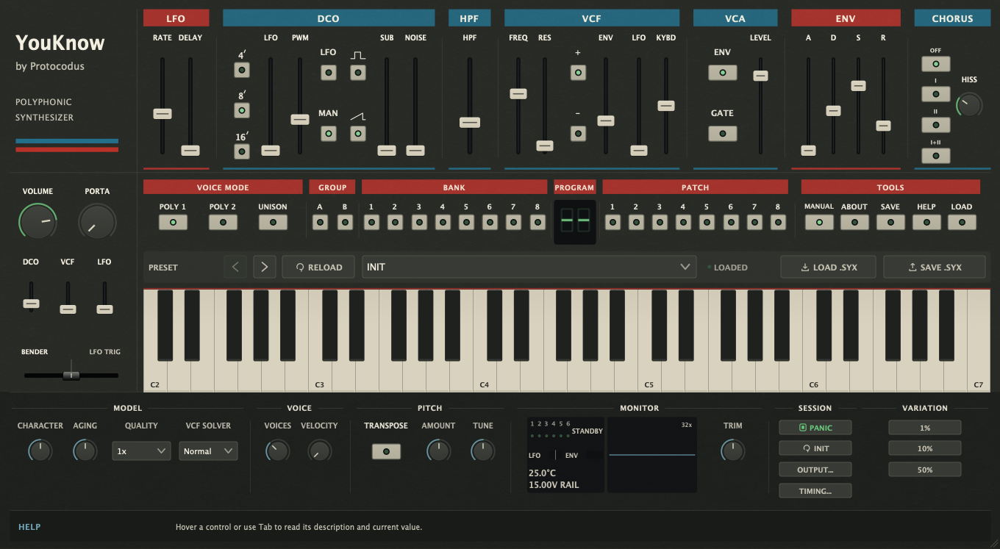

# YouKnow

A six-voice circuit-modelled synthesizer inspired by the Roland Juno-106,
with 144 presets, stereo chorus and hands-on sound design. It runs as a VST3
and CLAP plug-in and a standalone app on macOS, Windows and Linux, and as an
Audio Unit on macOS.



## Audio demos

Eight of the 144 presets, each showing a different side of the instrument:
brass stabs, strings under a slow top line, electric piano comping, a funk
riff, the unison bass, a lead melody, a synth pad and an effect. Each plays
its phrase from [Docs/audio/midi](Docs/audio/midi) through the shipping engine
on its deepest oversampling rung, written as 48 kHz 24-bit WAV. Every main
build renders them and rewrites this table.

<!-- audio-demos-begin -->

| # | Preset | Demo | Length | Peak |
| --- | --- | --- | --- | --- |
| 1 | A11 Brass Set 1 | [001-a11-brass-set-1.wav](Docs/audio/001-a11-brass-set-1.wav) | 10.5 s | -14.3 dBFS |
| 5 | A15 Moving Strings | [005-a15-moving-strings.wav](Docs/audio/005-a15-moving-strings.wav) | 11.5 s | -17.8 dBFS |
| 15 | A27 Elect. Piano I | [015-a27-elect-piano-i.wav](Docs/audio/015-a27-elect-piano-i.wav) | 10.0 s | -12.8 dBFS |
| 31 | A47 Funky I | [031-a47-funky-i.wav](Docs/audio/031-a47-funky-i.wav) | 10.0 s | -28.1 dBFS |
| 32 | A48 Synth Bass I (unison) | [032-a48-synth-bass-i-unison.wav](Docs/audio/032-a48-synth-bass-i-unison.wav) | 11.6 s | -20.0 dBFS |
| 33 | A51 Lead I | [033-a51-lead-i.wav](Docs/audio/033-a51-lead-i.wav) | 11.3 s | -30.6 dBFS |
| 48 | A68 Synth Pad | [048-a68-synth-pad.wav](Docs/audio/048-a68-synth-pad.wav) | 11.1 s | -18.0 dBFS |
| 61 | A85 Rocket Men | [061-a85-rocket-men.wav](Docs/audio/061-a85-rocket-men.wav) | 11.5 s | -23.8 dBFS |

<!-- audio-demos-end -->

### More demos

Four techniques the preset demos do not feature, each played from its phrase
in [Docs/audio/midi/more](Docs/audio/midi/more) on a front panel set up for it
in [`Tools/DemoPanels.h`](Tools/DemoPanels.h):

- [Filter brass](Docs/audio/more/01-filter-brass.wav): resonant
  filter-envelope stabs, then a held chord pushed up on the bender.
- [Self-oscillation](Docs/audio/more/02-self-oscillation.wav): the filter
  played as a voice at full resonance and key follow, with no oscillator
  running.
- [Unison glide](Docs/audio/more/03-unison-glide.wav): six voices on one key
  with constant-rate portamento.
- [Delayed vibrato](Docs/audio/more/04-delayed-vibrato.wav): the modulator's
  two-stage delay fading vibrato onto a held chord.

Longer listening material, the technique takes, five musical showcases, a
ten-part composition and the original preset sessions, is rendered locally;
see [local listening renders](#local-listening-renders).

## Version history

### 1.3.7 — 2026-10-26 — Switches follow a recalled preset; panel moves get through dense bends

- In Original timing, loading a preset or restoring a session now also sets
  the emulated panel's switch row (PWM, ENV polarity, VCA mode, HPF). Before,
  the firmware merged a later switch move over positions the panel no longer
  showed: moving a switch back to where it stood before the recall went
  unheard, and moving PWM on a Gate patch could switch its VCA to the
  envelope, so notes rang on after key-up. Patches received over MIDI keep
  the instrument's behaviour.
- In Original timing, a pitch-bend or modulation stream dense enough to fill
  the emulated MIDI cable no longer holds back panel moves until it stops.
  The firmware sends a panel edit only after the cable has been quiet for
  384 µs, so each merged controller message now leaves that gap: such a
  stream reaches the instrument at most about 740 times a second instead of
  about 1,040.

### 1.3.6 — 2026-10-26 — One line for main and the Rack

- Joins the two lines that both left 1.3.3: the 1.3.4 CPU trims below,
  which were on main, and the 1.3.4 and 1.3.5 work the Rack Extension
  ships, which was not. Both lines named a 1.3.4, so the two entries are
  marked by line.
- Every rendered sample is bit-identical to the 1.3.5 the Rack pins: all
  144 presets at 48 kHz, Normal Circuit Rate and Original timing, built
  with the Rack's compiler flags, through the
  [1.3.4 null-test harness](Docs/benchmarks/cpu-trims-2026-10-23.md#audio-parity).

### 1.3.5 — 2026-10-22 — Less repeated simulation work

- Inline finite-value classification on supported floating-point layouts to
  avoid full runtime classification calls at repeated safety checks.
  Circuit equations, processing defaults, presets, gain and latency stay the same.
  [Implementation and validation method](Docs/research/efficiency-1.3.5.md).

### 1.3.4 — 2026-10-22 — Continuous circuit controls (Rack line)

- Reconstruct the filter cutoff's curved settling between converter writes
  inside the existing voice circuit calculation.
- Follow the C58/Tr20 amplifier current through fast attacks, releases and
  fractional converter writes instead of joining gain endpoints with a line.
- Follow the changing chorus wet-switch load during its physical transition,
  retaining endpoint readout and settled gain.
- These numerical corrections retain the circuit values, parameter ranges,
  preset controls, gain calibration and reported latency. Their fine-step
  references establish improved simulation accuracy, not a new hardware fit.

### 1.3.4 — 2026-10-23 — Less CPU for the same samples (main line)

- Trims the voice filter's per-interval setup, reads the voice-island,
  chorus-island and output-summer FIR transports through contiguous windows,
  and takes the audio path's square roots in line. Every rendered sample is
  bit-identical to 1.3.3: all 144 presets at Normal Circuit Rate, a Max-rate
  subset, and Original and Direct timing. Circuit equations, kernels,
  processing rates, latency and noise chronology are unchanged.
- [Measurement and validation](Docs/benchmarks/cpu-trims-2026-10-23.md):
  about 5 % fewer instructions per block at the Rack's six-voice Normal
  configuration and 6 % at Max, on a development container, not a
  Reason-host measurement.

### 1.3.3 — 2026-10-22 — Release version for the Reason Shop

- Version number only: the sound engine, presets and parameters are the same as
  1.3.2. The new number lets the Reason Rack Extension ship as 1.3.3, above the
  1.3.0 already in the Reason Shop.

### 1.3.2 — 2026-10-17 — Active playback CPU

- Reuses fixed chorus terms and specializes the voice-noise covariance
  calculation. Circuit equations, processing rates and noise chronology stay
  unchanged; deterministic output comparisons retain identical sample bits.
- [Measurement and validation](Docs/benchmarks/active-playback-2026-10-17.md)
  distinguish native processing measurements from Reason-host performance.

### 1.3.1 — 2026-10-17 — Dense bend and modulation automation in Original timing

- In Original timing, pitch-bend and modulation messages that arrive faster
  than the emulated MIDI cable carries them (about 1,040 a second) now merge:
  a newer value replaces an older one still waiting to be sent. Dense host
  automation no longer delays notes by up to a second or cuts a held chord.
  Direct timing is unchanged.

### 1.3.0 — 2026-10-17 — Circuit Rate, about 30% less CPU, Original timing by default, PHONES output

- About 30% less processing for the same circuits, and a new Circuit Rate
  setting: Max (default) keeps the reference grid, Normal roughly halves the
  cost with six voices sounding.
- New instances play through the original firmware's note and scan timing;
  Direct timing stays in the TIMING menu and older sessions keep it.
- OUTPUT... adds the PHONES amplifier with declared headphone loads, and
  cable capacitance alongside receiver resistance.
- The product sound model chosen by ear on 2026-10-05: revised chorus motion,
  hiss and switching, quieter late voice tails and an interacting WAVE/SUB mixer.
- Fewer folded harmonics from the voice amplifier, output amplifier and
  WAVE/SUB mixer. Product latency is 120 samples at ordinary host rates.
- Every bundled sound recalls a calibrated Output Trim (TRIM knob); Unison
  plays 1.94 dB quieter and honours the bass presets' one- or two-voice stacks.
- Smaller default per-card spreads at 100% Unit Character, and fixes to HOLD,
  transpose, pitch-bend and All Sound Off handling.

### 1.2.0 — 2026-09-29 — Loaded chorus circuit, OUTPUT menu, combined firmware path

- The chorus input and reconstruction filters include finite transistor gain
  and loading, its clock moves between samples, and its switch follows the
  shared mute circuit. The nonlinear followers cost about 17–20% more CPU.
- OUTPUT... selects the output level and the receiving input's resistance,
  with load-dependent bass, treble and resistor noise.
- Pulse is 1.34 dB quieter against saw and chorus hiss uses the corrected
  capture target, both calibrated to one identified unit.
- The original assigner and voice-board firmware can run together for
  comparison; ordinary playback is unchanged.

### 1.1.0 — 2026-09-28 — 144 presets, all formats, Unit Character and Aging

- 144 presets: the original 128 factory tones plus 16 YouKnow bass and pad
  sounds, with hardware-format SysEx import and export.
- VST3, CLAP and Standalone on macOS and Windows, plus Audio Unit on macOS.
- Unit Character, Aging, velocity, adjustable polyphony, unison and tuning
  controls, with a scalable panel and contextual help.
- The owner's four listening decisions of 2026-09-22 and a long run of
  circuit and firmware corrections.

[Every change in detail, with compatibility notes](Docs/release/release-notes.md).

## Downloads

<!-- build-download-begin -->
**[Download main build 20](https://github.com/protocodus/virtual-instrument-youknow/actions/runs/40474656554/artifacts/12730434206)**, built from [`446fc5feb4f7`](https://github.com/protocodus/virtual-instrument-youknow/commit/446fc5feb4f750132ec5a4523a3b325ec70cda81). It holds the macOS, Windows and Linux packages, `SHA256SUMS` and `BUILD.txt`.
<!-- build-download-end -->

Each main build holds the macOS universal `.pkg` installer and manual-install
`.zip` (VST3, Audio Unit, CLAP, Standalone), the Windows x64 `.zip` and the
Linux x64 `.tar.gz` (VST3, CLAP, Standalone), named
`YouKnow-<version>-build.<run>-<platform>`, with `SHA256SUMS` and `BUILD.txt`.
The About box shows the same `<version>-build.<run>`. These are development
builds: the macOS bundles are ad-hoc signed and not notarized, and the Windows
binaries are unsigned. Main builds are kept for 30 days and require a GitHub
sign-in to download. A `vX.Y.Z` tag drafts a signed, notarized
[GitHub Release](https://github.com/protocodus/virtual-instrument-youknow/releases);
none has been published yet.

**Installation:** [macOS](Docs/guide/install-macos.md) ·
[Windows](Docs/guide/install-windows.md) · [Linux](Docs/guide/install-linux.md) ·
[user guide](Docs/guide/user-guide.md) ·
[preparing files for the e-shop](Docs/release/e-shop-distribution.md).

---

## How it works

YouKnow models the voice architecture of a 1984 six-voice polysynth — the
Roland Juno-106 — block by block, from its integer-divided note timers through
its four-pole transconductor filter to its uncompanded bucket-brigade chorus:
a scanned control converter with per-hold slew and 7-bit patch digitisation,
firmware envelopes with exponential decay into a measured quasi-linear
amplifier, an implicitly solved resonance loop with input-side compensation, a
non-stealing key assigner, and a two-line MN3009 chorus with authentic
saturation and noise.

It is an independent original implementation, not affiliated with or licensed
by Roland Corporation, and contains no firmware, ROM data, samples or captured
audio. It does include the original 128 factory tone-memory states as
functional 18-byte parameter data, independently decoded and checksum-verified;
no Roland Cloud content was extracted. Its panel keeps that instrument's
control order, with worn charcoal, aged ivory controls and blue/red section bands and green LEDs. Consistent spacing separates functional groups; a larger preset
toolbar and scalable vector controls remain readable across the supported sizes.

### Sources

**Primary documentation and parts.** Roland JUNO-106 Service Notes, First
Edition (31 July 1984) — two byte-identical circulating scans, read at page
level, with pixel-measured reads of p. 8 (timing chart) and p. 9 (module
drawing); the Owner's Manual; two Roland Service Information bulletins
(100222, 100229). Hash-identified firmware images (voice/main B-2, assigner
A-5) analysed behaviourally, alongside published clean-room assigner reverse
engineering and a pinned [unofficial partial IC29 disassembly](https://github.com/ErroneousBosh/j106roms/blob/26926a04ff1939106820313e71e34b4ca2f67070/ic29.txt)
used only as corroboration. Datasheets for the Panasonic MN3009 and MN3101,
NEC µPC1252H2, Toshiba TA75558, TC4051/4052/4053B and 2SK30A, Hitachi
HD14051B, [OKI MSM82C53](https://www.bitsavers.org/components/oki/_dataBooks/1986_OKI_Microprocessor_Databook.pdf)
and Intel 8254/8253, NEC µPD7810/7811, TI [TL062](https://www.ti.com/lit/ds/symlink/tl062.pdf)/TL072/TL082, Rohm BA6110 and Alfa
AS3109/AS662; and [Nippon Chemi-Con's aluminum-electrolytic voltage-bias guidance](https://www.chemi-con.co.jp/en/faq/detail.php?id=alBiasVoltageChara).
A1QH80017A VCF/VCA module teardown photographs, the
Open80017a/dksynth module reconstruction, and published DCO charge-circuit
analysis. The Roland JUNO-6 and JUNO-60 Service Notes' CPU-board voice
drawings (p. 9 in both), which print the discrete IR3109 + BA662 voice circuit
the 80017A integrates, are read for one value the 106's own drawings leave
blank: the voice VCA's 47 kΩ output load (R42). The Roland MKS-7 and
HS-60/JUNO-106S Service Notes (July 1985) test the same MC5534A/80017A voice
and list this module board as common, and supply sibling end-to-end levels and
a second drawing of the noise network.

**Measurements and archives.** KR-106 (click-timing chorus series, measured
code-to-frequency, LFO-rate and sustain tables, a background-noise capture,
archival tone transcription — comparison and bracket material, not hash-pinned
here; the click series and the background capture name no unit); ModWiggler
and Gearspace measurement threads read at post level; the Alpes Machines
One-O-Six kit guide; the atosynth reconstruction; Cornutt workbench pages;
Analogue Renaissance service notes. For the chorus, the sibling JUNO-60
Service Notes and chorus measurements are labelled comparison only — the
JUNO-60's 1.682 mode-rate ratio must not return; this instrument's own is
1.6234799 — while their voice drawing serves the VCA load above.

**Literature.** Zavalishin (TPT, `1/(4−k)`); Stilson & Smith; Huovilainen;
D'Angelo & Välimäki; Välimäki, Pekonen & Nam (BLEP residuals); Holters &
Parker (BBD modelling, DAFx-18); Gabrielli, D'Angelo & Squartini (DAFx-25,
BGA/SGA and BBD polyBLEP); Danish, Bilbao & Ducceschi (DAFx-21, the basis of
a rejected solver candidate).

### What is modelled

The [modeling research and assessment](Docs/research/modeling-research-2026-09.md)
evaluates the current circuit model and recent virtual-analog methods against
the evidence still needed to qualify them. The
[hardware validation report](Docs/validation/hardware-validation.md) records a
reproducible comparison against Juno-106 #439522 with replacement voice cards,
the resulting circuit and SysEx fixes, and the unresolved noise-level mismatch.

Each mechanism carries an evidence class, defined and tracked per constant
below: **anchored** (service
documentation, datasheet, firmware analysis or calibrated measurement),
**ROM-resolved** (exact for one hash-identified firmware image),
**derived** (arithmetic from anchors), **product policy** (a plug-in
decision, no hardware claim) or **voiced** (provisional, inside a range the
evidence bounds but does not fix). "Exact" never means an arbitrary
forty-year-old unit will null against the plug-in.

**Digital control system**

- Pitch is one 8 MHz reference divided by a 16-bit integer count. The recovered
  B-2 path uses one unsigned 8.8 coordinate, clamps its high byte to table
  indices 0..102, and truncation-interpolates a paired timer count and 12-bit
  DCO-CV code. Those mechanics are ROM-resolved; compact smooth anchor
  generators avoid embedding the proprietary 104-word tables and stay within
  four timer counts (1.272 cents over the complete coordinate) and one CV code
  of the hash-matched image (derived). RANGE changes IC35's synchronous preset,
  not the PIT count: terminal carry makes TP5 fall and clocks the PIT; one
  nominal raw-8 MHz tick later (125 ns at exactly 8.000 MHz) IC35 reloads,
  with the corresponding TP5 rise following propagation, and subsequent
  periods use the new ÷2/÷4/÷8 cadence (anchored topology; derived nominal
  timing; propagation unmodelled).
- One 12-bit converter scans 23 sample-and-hold destinations — 18 per-card,
  5 shared — over a 4.2 ms pass in the service chart's exact write order,
  on a fractional scheduler with per-destination hold networks (anchored
  order; VCF and voice-VCA cross their designator-complete post-hold RC —
  the voice-VCA now solves C58 with Tr20's changing incremental load: its
  time constant approaches (R106 10 kΩ ‖ R105 22 kΩ) × C58 0.1 µF = 687.5 µs
  at high current and 1 ms as the transistor closes, retaining the existing
  junction/knee calibration and DC gain; an independent voltage-node RK4
  oracle checks the physical capacitor voltage across quiet and large steps,
  and the VCF's C61 sits behind the unread WIDTH trimmer, so its 522 µs is a
  point inside a 467–553 µs bracket — as do PWM/SUB/common-VCA; the DCO
  pitch-CV, NOISE and RESO holds have no post-hold network at all and use
  ideal acquisition at the write. Between writes every hold ramps at its
  HD14051B channel's 10 pA typical off-leakage plus its follower's typical
  input bias — 65 pA for the TL08x parts behind IC24's DCO and SUB holds,
  30 pA for the TL064s behind IC23's VCF/PWM/VCA LEVEL and IC26's
  ENV/RES/NOISE holds, the follower's share doubling every 10 °C as TI
  states — 0.013 or 0.007 of a 2.45 mV LSB per pass, applied on the drift
  cadence in the direction of a falling hold (`enableConverterHoldDroop`, a
  product selection like the serviced VCF calibration, off in the engine's
  ideal-hold reference configuration; the sheets give magnitudes only, so
  the sign is a stated convention). Actual acquisition remains unmeasured:
  the switch datasheet does not establish a sub-10 µs settling bound. The
  intra-pass offsets follow the pixel-measured
  geometry of the p. 8 timing chart, chosen by ear over the normalised
  `ordinal/23` placement on 2026-09-04 — drafting proportions, not hardware
  timestamps — with the normalised and phase-zero profiles still selectable
  for comparison).
- Envelope recurrence, sustain mapping, DAC truncation, the onset-scaled LFO
  reaching DCO and VCF — the cutoff term is B-2's own pass-held word, the
  doubled panel byte times the onset byte truncated to one depth byte and
  multiplied into the 13-bit accumulator, so panel byte 1 sways the cutoff
  by 15 counts rather than a proportional 32 — and the portamento glide law
  are the exact digital behaviour of the hash-identified B-2 firmware. PWM
  separately reads the raw accumulator, forms and pass-latches B-2's exact
  12-bit DAC code, and preserves its seven-bit overrange (ROM-resolved); key
  assignment — including note dropping instead of stealing, the momentary
  POLY contacts and Solo Unison — is ROM-resolved for the A-5 assigner image.
- The portamento knob passes through its loaded 50KB pot law (derived).

**Oscillator**

- A straight Miller-integrator constant-current ramp with finite reset, a
  comparator-based pulse against the shared scanned PWM threshold, and a
  divide-by-two sub (anchored topology). Roland's
  [DCO drawing and text](https://www.synfo.nl/servicemanuals/Roland/ROLAND_JUNO-106_SERVICE_NOTES_1st.pdf#page=9)
  give an approximately 12 Vpp Miller ramp; its PWM anchors are consistent
  with a nominal 0 to approximately +12 V excursion. B-2's [PWM arithmetic](https://github.com/ErroneousBosh/j106roms/blob/26926a04ff1939106820313e71e34b4ca2f67070/ic29.txt#L1144-L1197)
  and [12-bit converter write](https://github.com/ErroneousBosh/j106roms/blob/26926a04ff1939106820313e71e34b4ca2f67070/ic29.txt#L1292-L1302)
  reproduce the full −0.8 to +6 V calibrated path. The uniquely loaded
  [PWM panel pot](https://www.synfo.nl/servicemanuals/Roland/ROLAND_JUNO-106_SERVICE_NOTES_1st.pdf#page=11)
  reaches the printed 95% point near stored byte 101. Roland's factory bank
  stores no PWM byte above 105 and ten tones sit exactly on it, while every
  other control reaches 127, so its programming unit's pot stopped at 105
  (96.5% here), inside the printed 93–97%. An identified unit's manual sweep
  of bytes 0–105 follows this byte-to-duty law within 1% duty at every byte
  (`Tools/AnalyzeHardwarePwm.py`). The plug-in's PWM slider stops there
  too, at the owner's request (2026-09-22): its full travel stores byte 105,
  and a patch or SysEx byte above the pot's reach is held at that top. The
  engine keeps the firmware's whole seven-bit law, in which bytes from 113
  pin the comparator high. Pulse Off's documented −0.8 V hold
  likewise pins the comparator high without disconnecting the WAVE node; that
  constant level now remains on the modelled node and C56/C50 remove its DC,
  so off/on automation follows the comparator and coupling state instead of a
  digital mixer gate (anchored topology; absolute node level remains OQ-15).
  The shared PWM control now follows the actual C62 feedback and C63 output
  networks: (R118 + VR31) × C62 gives a nominal 3.249 ms pole, and R119 × C63
  gives 0.2209 ms. The previous 4.7/2.632 ms values incorrectly used the
  input and bias resistors. The inferred service trim lies within VR31's
  full-travel 2.632–3.572 ms bracket; the established DC duty calibration is
  preserved. On held-out modulation depths in the identified hardware take,
  normalized span RMS error falls from 1.736 to 0.373 percentage points;
  static duty and LFO-rate differences are reported separately.
  C54 charge now integrates the currently held DAC-controlled current. A
  count write cannot change that current in advance of its separate CV write;
  changing the current preserves voltage already stored in the capacitor.
  Normalization uses the fixed B-2 `0x5400` reference, so the actual count,
  clock period and range resistance determine the resulting amplitude. One
  C54 draw (±2%) and three range-resistor draws (±1%) persist per card; the
  current multiplier is reciprocal R×C, with one fixed comparator service
  adjustment constrained by both duty acceptance windows. These deterministic
  draws respect component envelopes at Unit Character 100%; they are not a
  measured population distribution.
- Physical DCO state continues behind a closed VCA. B-2 selects a count-only
  update or a Mode-3 control word according to note history; the latter can
  alter OUT and restart the counter. Phase therefore depends on prior state
  and ordered CPU writes, with no per-note random phase draw. Oscillator edges
  are bandlimited (BLEP/BLAMP) as a numerical product mechanism. The custom
  IC's reset curve remains unmeasured: the shipping finite-linear reset is
  retained, while an explicitly configured exponential discharge integrates
  retained C54 charge through the same PWM and audio path.
  Finite amplifier gain could curve the charge ramp and parasitic switching
  could add flyback feedthrough, but Roland supplies neither the MC5534A's
  open-loop gain nor a measured glitch waveform. A gain of 2500, a 100–300 mV
  spike and a 0.5 µs decay would be new assumptions. Comparator propagation
  delays and input-noise spectra are likewise unmeasured; existing per-card
  threshold offsets already share the two service duty-cycle constraints
  with ramp tolerances. An extra independent offset would count that mismatch
  twice, and a per-sample random transition would not identify its bandwidth.
  For a constant-gain Miller integrator, `tau = R*C*(A+1)` and
  `v(t) = -A*Vin + (Vreset + A*Vin)*exp(-t/tau)`. This is a conditional
  circuit model, not a measurement of the MC5534A's gain. With instantaneous
  reset, its harmonic ratio is `abs(Hn/H1) = sqrt((1+b*b)/(n*n+b*b))`,
  where `b = 1/(2*pi*f*tau)`. At 130.0797 Hz with assumed gain 2000,
  399 kΩ and 1 nF, H2 is only 0.00000765 dB above the ideal `1/2` ratio;
  it does not explain the 0.0286 dB deficit in the
  [historical steady-output benchmark](https://github.com/protocodus/virtual-instrument-youknow/blob/2fbfee540eb41953d3d2f555904ec05ae3938e67/Docs/benchmarks/harmonics-2026-09-05.json).
  That recording includes replacement VCF/VCA cards and the recording chain;
  its harmonic magnitudes do not identify a DCO component or an attack transient.
  Charge injection likewise needs a measured switch waveform: `Q/C` gives
  a voltage step from an assumed charge, not its polarity or recovery time.

**Mixer and noise**

- Fixed legs, not switchable mixer resistors: saw and pulse arrive summed on
  one WAVE node, Pulse Off leaves its comparator's constant-high state there,
  the sub joins through the module-board legend's
  [1SS133 diode](https://www.synfo.nl/servicemanuals/Roland/ROLAND_JUNO-106_SERVICE_NOTES_1st.pdf#page=12)
  as a half-cycle current (its half-wave mean
  rides on the WAVE node and is what C56/C50 remove when the SUB level
  changes). Tr19, the sub's switch, leaves saturation later than it enters
  it, so the half-cycle D6 conducts begins late by its storage time and the
  sub carries H2 = π·t_s·f_sub on an otherwise even-free square: −88 dBc at
  the 16′ bottom key, −64 dBc at the 4′ top. The 0.2 µs is the era's
  small-signal switching class (2N3904 200 ns maximum, 2N2222A 225 ns
  typical); Toshiba's 2SC1815 sheet lists no switching times, so the value is
  a borrowed class figure, not the installed part's (`enableSubStorageSkew`).
  The delayed collector edge retains its remaining physical time across audio
  sample boundaries and quality-grid changes; it is no longer truncated when
  the divider edge arrives near the end of a sample. Independent delayed-square
  Fourier checks bound the tested H2 error to 0.00124 dB without changing that
  part-class estimate.
  The held SUB rail now crosses a soft silicon-diode threshold:
  one aggregate resistor/current scale, 8.896 V, fitted on alternating levels
  of an identified original-DCO recording reduces the worst error on the
  held-out levels from 18.50 to 0.282 dB. SUB 0 and full level are unchanged.
  Since the 2026-10-05 B selection, the product solves WAVE, Tr19, D6 and
  C56 together, so saw/pulse voltage changes the sub's diode current and
  loading. The saw's unipolar DC enters that solve before C56 removes the
  settled mean. The measured 8.896 V aggregate and existing full-SUB balance
  constrain a named source prior: approximately 4.98 kΩ, the lower of two
  compatible solutions, not an installed MC5534A reading. The reconstructed
  hybrid's 3.969 kΩ input load and 68 kΩ/4.7 kΩ ratio convert physical pin
  voltage into the cascade coordinate. The 0.738 oscillator-drive and 0.857
  pulse-balance conventions stay explicit; the diode law and C56 each run
  once. A 0.6 V diode reference and ideal grounded collector remain priors.
  The product now reconstructs the outputs of both physical Tr19 switch
  states with the unclipped signed BLEP weight, then updates C56 once. It
  no longer clips the bandlimited edge or interprets intermediate weights
  as simultaneous fractional conduction. In a 1,760 Hz SUB fixture at
  48 kHz, wanted-harmonic error against continuous binary switching and
  C56 integration falls from −27.75 to −99.35 dBr. This is numerical
  convergence with the declared diode/source model, not a hardware capture;
  nonlinear interaction with a moving WAVE source retains a residual.
  Mixed-source captures and node readings are still needed (OQ-15). One
  shared Tr21 noise source — a reverse-biased emitter-base avalanche
  junction, so its amplitude statistics are Gaussian by the central limit
  theorem and the generator draws Gaussian deviates at the uniform draw's
  RMS, keeping the crest factor independent of the quality rung (derived)
  — crosses C42's 33.9 Hz high-pass into the scanned BA662 level
  OTA, whose output drives the stateful C41/R79 4.8 kHz pole before feeding
  every voice (anchored topology, shaping and control ordering; the level
  coordinates remain voiced). The product sets both levels by the owner's
  2026-09-22 choices by ear (`Docs/decisions.md`), and the raw engine keeps
  the voiced coordinates. The shared source runs ×2.281, reading Roland's
  4 Vp-p TP8 noise trim as the trace's dense core (2.9σ) rather than its
  whole extent (OQ-16). The saw, pulse and sub legs run ×0.738, putting the
  nominal saw at 4.83 Vp-p at TP8, inside the MKS-7 Service Notes' factory
  window; the digital boundary returns their loudness, so only the drive
  into the filter and VCA changes (OQ-15). The scanned NOISE hold reaches the BA662's
  control pin through Tr22's grounded-base stage (R115 10 kΩ plus VR32
  100 kΩ in series, R114 2.2 MΩ to −15 V), so the level is zero below one
  junction drop plus the trimmer-dependent pull-down offset and linear above
  it in the raw-reference approximation. The product instead solves the
  nominal exponential junction and R114 loading: low stored bytes acquire
  noise gradually, with exact Off and full level retained. The 25 °C
  2SA1015 prior is extrapolated to the microampere knee, and VR32 remains at
  the existing nominal end-stop; neither is an installed-part calibration.
  The OTA's
  input saturation of the noise is not modelled: its drive depends on Tr21's
  selected amplitude and on VR32, neither fixed (OQ-16).
- C56/C50 reject the mixer's settled DC while passing changes in its mean as
  decaying transients into the nonlinear filter. Their state already follows
  pulse duty, the half-wave SUB mean and saw amplitude, including behind closed
  voice VCAs; Note On does not reconnect an idle oscillator as a fresh DC step.
  The 10 µF capacitor is anchored, but the full WAVE source/load impedance is
  not. The earlier independent product model used
  `4.7 kΩ || (24 kΩ + 1.5 kΩ)` = 3.969 kΩ, giving about 39.7 ms settling
  in the low-frequency, stiff-source approximation. The selected coupled
  model retains that physical load but includes source resistance and D6's
  changing junction conductance, so its C56 settling is no longer that fixed
  one-pole approximation. The earlier reduction replaced the voiced
  33 kΩ / 330 ms stand-in following the owner's
  [delegated evidence choice](Docs/decisions.md#2026-09-15--adopt-coupling-b-on-circuit-evidence).
  The resistor proportions come from the
  [hybrid reconstruction](https://github.com/ThomHPL/Open80017a/blob/5561ee3ea8eaa6299c9ce0c79df4df43658f9efa/Outputs/Open80017a.pdf);
  the JUNO-6/60's corresponding 10 kΩ / 47 kΩ network supports the same
  topology but gives a different input load. Multiplying 10 µF by an internal
  68 kΩ stage resistor does not establish a 680 ms installed pole.
  In particular, the 68 kΩ/560 Ω stage attenuator is not the complete pin-1
  load: the reconstructed hybrid also has a 4.7 kΩ summing path and a
  24 kΩ/1.5 kΩ resonance-input branch. SUB current also loads the WAVE
  source, while C56 blocks its settled DC; multiplying that current by
  68.56 kΩ alone does not establish a 5.3 V step. Inside the OTA cascade,
  the differential drive includes the evolving capacitor state and feedback.
  A biased memoryless `tanh` can generate even harmonics, but it cannot
  establish the filter's attack spectrum or its decay from C56 alone.
  `YouKnowRenderOscillatorEnvelopeCircuits coupling OUT TOTAL_OHMS` auditions
  an explicit effective resistance against the earlier independent profile,
  preserving gains and capacitor state. Its held-note control changes and
  bass/pluck score isolate that pole; raw and stereo-RMS-matched WAVs retain
  the comparison without changing a preset or product default. The raw-engine
  reference retains 33 kΩ for legacy fixtures and explicit comparisons.

**Filter and voice amplifier**

- Four transconductor stages with the 68 kΩ/560 Ω attenuation, solved
  directly as their continuous nonlinear equations at fixed cost; cutoff is
  summed in converter counts (1143/octave) and anchored on the service
  calibration point — code 6272 self-oscillates at 248 Hz, which the model
  *predicts* within a cent from a derived harmonic balance rather than
  fitting (anchored law; the upper knee is voiced pending OQ-18).
- The existing filter carry profile, inferred from one unit's code-to-frequency
  measurements rather than a direct DAC voltage sweep, the resonance input-side
  compensation Roland's own module drawing prints, self-oscillation trimmed
  where the service manual trims it, and the printed ±10-cent trim
  acceptance windows at the two check points (anchored; the shipped
  panel-to-loop-gain curve follows the traced linear CV-to-BA662 path above
  its junction onset, measured from the anchored +0.26 V VR34/TP7 standoff
  the RES CV hold shares with the voice VCA rail, while the exact onset and
  compensation await OQ-09).
  The product now uses Tr18's exponential emitter law with the same nominal
  25 °C 2SA1015 prior as Tr22. The accepted loop endpoint implies 229.6 µA
  into the reconstructed 68 kΩ summer; emitter KCL then gives R107 plus
  VR26 ≈42.05 kΩ, inside the drawn 27–47 kΩ range. The small zero-control
  baseline is removed to retain an exactly open loop, and full travel keeps
  the existing service calibration. These are conditional circuit coordinates,
  not installed junction or trimmer measurements. The raw reference keeps
  its hard 0.6 V onset; the nominal table agrees with an independent current
  solve within 2.1×10⁻⁶ absolute loop gain.
- FREQ/WIDTH calibration now stays fixed when RES changes, as the separate
  cutoff and resonance control paths on service-note p. 13 require. The
  cascade retains its own amplitude-dependent frequency droop; the former
  live resonance correction cancelled that behaviour. Full-RES service
  tuning is preserved for each card. On held-out portions of the identified
  unit's resonance sweep, spectral-ratio error falls from 2.931 to 1.982 dB
  RMS with the same noise calibration in both renders. This supports the
  wiring correction without identifying every resonance component value.
- The resonance BA662 carries its own input offset into the loop: a signed
  per-card draw with a named ±250 µV span at the pair. Open Music Labs measured
  two original BA662As at 30/250 µV; this is an explicit estimate rather than
  a population bound. The previous voiced ±1.5 mV BA6110-family span remains
  available for comparisons. Nothing on the board nulls the resonance offset;
  it is referred to the node through the OTA's 100 kΩ/1.5 kΩ
  divider and added to the pair's differential input inside the loop return,
  so its gm·V_os feedthrough follows the resonance control current and is
  exactly zero with the loop open. A RES change moves the loop's DC operating
  point, which C59 turns into a small thump, and self-oscillation settles per
  card. It is scaled by Unit Character and absent at zero. Original current
  dependence is unmeasured; the AS662D sibling permits up to 1 mV of change
  across 5–500 µA, so the fixed offset model remains an approximation.
- Both of the loop's headrooms are the same 2 Vt seen through a resistor
  ratio — the stages' through 560/68560, the resonance return's through its
  100 kΩ/1.5 kΩ divider — and both OTAs sit in one potted 80017A at one
  temperature, so the return's headroom now warms with the stages' instead
  of staying at its 25 °C value while they moved. Scaling the two together
  leaves the limit cycle's loop gain and droop invariant (the derived
  frequency-trim table is exact at any temperature) and lets its amplitude
  grow with the card: at Unit Character 1 the settled full-RES
  self-oscillation would sit 5–6 % above the 4.8 Vp-p figure. Roland's
  ADJUSTMENT (p. 19) sets each card's RES trimmer for that figure after ten
  minutes, before FREQ, so the model now solves each card's full-travel loop
  gain from the same harmonic balance the FREQ trim already uses — the gain
  that sustains 2.4 V peak with the card's pole spread and settled headrooms,
  as a ratio to the nominal card's solve so Unit Character 0 keeps its
  endpoint bit for bit. With the voiced post-trim residual cleared, every
  card settles between 4.796 and 4.804 Vp-p at code 6272; a cold card starts
  near 4.15 Vp-p and grows into the figure on the warm-up law; the
  complete-voice ±10-cent FREQ/WIDTH windows hold at a worst of 2.02 cents
  with the ±2.5-cent serviced residuals.
  The FREQ solve carries the adjustment's shift of the loop gain the
  frequency-trim table is read at; the voiced residual stays out of it as
  before (anchored physics and procedure; `enableResonanceHeadroomTemperature`
  and `enableResonanceServiceTrim` keep the former arithmetic for A/B renders).
- The former product profile enables `useServiced439522VcfCalibration`, assigning fitted
  FREQ/WIDTH and effective current-ceiling coordinates to six fixed card
  slots. Native 192 kHz renders reduce per-card held-out tuning error from
  42.0–56.8 to 9.7–22.2 cents RMS; worst error falls from 243.6 to 45.9 cents.
  Those are steady codes from one serviced instrument with Borish replacement
  cards. The profile does not establish original-module tolerances or drift,
  and its ascending-sweep startup discrepancy remains visible. Representative
  192/384 kHz renders differ by at most 2.42 cents, so fitted decimal places
  are not physical measurement precision. Unit Character and Aging add their
  existing variation to that measured base. The 2026-10-05 product selection
  uses the existing nominal original-hybrid/service frequency law instead
  (`useOriginalCardVcfCalibration`), preserving the nonlinear cascade and
  Tr18 resonance model. This avoids treating the replacement-card fit as an
  original-card calibration; original population tolerances and the actual
  resonance-versus-byte curve remain unmeasured.
- C59's 1 µF voice coupling follows a conditional service-derived load.
  The [module board](https://www.kiwitechnics.com/downloads/Kiwi-106/Roland%20Juno-106%20Service%20Manual.pdf#page=13)
  puts R108 82 kΩ and VR27 0–50 kΩ ahead of the hybrid's 4.7 kΩ/560 Ω
  input network. Applying the already accepted BA662 signal law to Roland's
  4.8/6 Vp-p service targets gave the former product profile VR27 ≈32.94 kΩ
  and a total load of ≈120.19 kΩ at 25 °C, hence a 1.324 Hz corner. The
  selected Tr20 operating point now derives the same divider and C59 load
  consistently with its BA662 current and service gain. Each card's fixed service
  temperature and input trim set its own load; warm-up does not re-trim it.
  The digital filter retains unity passband because the signal law already
  includes divider attenuation. TP19 is after C59; its 4.8 Vp-p is not a
  measurement of the capacitor's source. The nominal calculation assumes a
  low-impedance VCF buffer and ideal BA662 input, and inherits the existing
  tail-current and mirror-gain priors. Those impedances, capacitor tolerance
  and the installed trim remain unmeasured. Raw reference engines retain
  the former R108-only 82 ms approximation.
- Each voice VCA is a current-controlled BA662 behind C59 coupling, whose
  control current follows the traced grounded-base stage's own resistor-fed
  emitter law — R106 + R105 = 32 kΩ, kT/q, the VR34 +0.26 V standoff —
  solved exactly (y + ln y = v) and tabulated. The selected 25 °C Toshiba
  2SA1015 prior, β 200 and Vbe 0.61 V at Ic 0.650966 mA, gives a conditional
  177.78 mV knee instead of the former voiced 150 mV coordinate. Late decays
  and releases close more quietly while the ROM envelope stays unchanged.
  C58 loading, collector current, pair headroom, C59 and service normalization
  follow that same operating point. This extrapolates a named component
  specimen; original Tr20 and BA662 low-current behavior remain OQ-19.
  Its signal path is
  the bare differential pair's `tanh`, driven as hard as Roland's own trims
  say: the 6 Vp-p VCA GAIN and 4.8 Vp-p RESONANCE adjustments on the same
  bank and key fix the pair's drive from the output side alone — 3.0 V
  across the load against about 301.5 µA at full sustain — so the pin-9
  input divider cancels. An [original-module measurement](https://www.sounddoctorin.com/synthtec/roland/juno106.htm)
  corroborates the 47 kΩ output load and 4.7 kΩ/560 Ω input resistors; the
  sibling JUNO-6/60 drawing separately supplies the same load (R42). That puts
  about 11.17 V of headroom at the filter-output node and predicts a −48 dBc third
  harmonic at the trim level, −36 dBc at twice it and about −30 dBc with
  −0.9 dB of compression on a full open-filter voice, where the open
  cascade's own stages are nearly linear and the pair is the dominant
  odd-order term; the shape is the same at every envelope level because the
  tail current scales with control and the input drive does not (derived
  from service trims and corroborated original-module resistors; the
  parallel output capacitor and installed transfer remain OQ-19).
  On coarse grids the product locally oversamples that unchanged pair and
  envelope multiply before filtering out ultrasonic harmonics. This keeps
  real audible distortion while reducing folded lines; the numerical FIR
  filters lose at most 0.04 dB through 20 kHz at 44.1 kHz. Control and audio
  reconstruction share a timestamp; their 48-internal-sample delay is
  included in host compensation. Raw reference fixtures retain the direct law.
  The product now runs the existing VCF and C59 inside this same FIR pair.
  Its local 176.4/192 kHz grid can represent the control law's open-filter
  poles instead of limiting them to 21.6 kHz at 48 kHz/1×. A small-signal
  50 kHz four-pole fixture at 12 kHz changes from −4.066 to −0.967 dB;
  the independent analogue prediction is −0.973 dB. The existing FIR delay
  is reused, not added again. Seven-node cutoff/resonance trajectories,
  envelope gain, component offsets, temperature and physical noise density
  follow the reconstructed input. The separate, uncalibrated audio-energy
  rail proxy also sees that input delay (24 parent samples); it remains a
  voiced approximation rather than a physical power-supply simulation.
- The product also adds the bare OTA pairs' collector shot-noise component,
  separately from resistor Johnson noise. [TI's transistor-noise model](https://www.ti.com/lit/pdf/snoa626)
  and [ADI's Schottky relation](https://www.analog.com/media/en/training-seminars/tutorials/MT-047.pdf)
  supply `2qIc`; projecting two collector sources through an ideal quiet
  shared tail gives differential-current PSD `2qItail(1−tanh²(u))`.
  The existing nonlinear voltage/current laws determine each tail current.
  Four stage sources enter their own 240 pF capacitors; the resonance OTA
  enters the first pair through the reconstructed 68 kΩ summer. A locally
  frozen midpoint Jacobian integrates each interval's physical covariance,
  rather than adding noise on every solver evaluation. Independent continuous
  ODE and projected-node tests qualify the numerical solve, including saturated
  pairs; small-tolerance factor reuse saves CPU. The actual-filter PSD tests
  compare sampled continuous noise, including its alias sum, rather than
  claiming an unaliased analog spectrum on coarse grids. Midpoint freezing,
  source interpolation and the existing numerical filter remain approximations.
  At nominal 25 °C and 248 Hz, the four open-loop stage sources predict about
  68.2 µVrms total continuous-band filter output. At the service sustain current,
  the voice VCA's 47 kΩ load receives 462 nV/√Hz (65.4 µVrms over 20 kHz)
  at zero differential drive. Its current noise is added after signal gain
  at the local antialias rate, using the same delayed envelope timestamp.
  All new sources have independent deterministic streams; physical-card idle
  draws and hard-reset behavior are preserved. RMS follows Unit Character,
  retaining exact zero there, and raw-reference engines leave the feature off.
  For the identified BA662 resonance and voice-VCA circuits, the product now
  includes output-mirror and tail-mirror noise as separate physical sources.
  Three Wilson mirrors route IN+ once and IN− twice. In the matched high-beta
  limit they add `2qItail(3−y)`, where `y=(Iplus−Iminus)/Itail`; together with
  the pair they quadruple its zero-drive noise power (+6.02 dB). The equal
  500 Ω emitter-resistor prior in the existing BA662 tail mirror gives
  `S_tail=4qItail(1+2r)/(1+r)²`, `r=Itail·R/Vt`. It reaches the output as
  `y²·S_tail`, vanishing at balance and growing with signal drive. These are
  conditional high-beta, quiet-control-current reductions, not fitted excess
  factors. [Open Music Labs' original-BA662 account](https://synthcube.com/open-music-labs-ba662-ota-clone/)
  identifies Wilson mirrors; its [OTA analysis](https://www.openmusiclabs.com/files/otadist.pdf)
  and the [ALFA manufacturer diagram](https://www.ericasynths.lv/media/AS662D.pdf#page=3)
  corroborate the routing. ALFA draws 400 Ω emitter parts; no surviving
  original-BA662 measurement has been verified for the inherited 500 Ω prior.
  No mirror topology is inferred
  for the IR3109 stages. Installed beta, base resistance, current-source noise
  and flicker spectra remain unmeasured. Before these mirror additions, a
  paired 48 kHz six/16-voice
  patch benchmark measured about 33–45% more CPU at 4× and 52–55% at 1×;
  this is a tested workload, not a universal performance bound. Further
  incremental screens measured less than 1% for output mirrors and roughly
  0.6–5.8% for tail mirrors. Repeated tail timings varied with order and
  scheduling; these are cost observations rather than a precision bound.

**Bus and output**

- Six voices sum at 0.1 each; one continuous C14 state feeds the
  four-position high-pass (derived shelf and cut corners, MNA-qualified).
  The two cut legs and the Boost leg keep their own charge: IC3 selects
  which leg drives IC4a's summing node but disconnects none of them, so a
  departed cut leg's capacitor bleeds into the node through its 1 MΩ and
  47 kΩ, and the Boost leg runs as its three real stores — C9‖R22 into C8,
  and C6 across IC4b's ×11 feedback — so that leaving Boost discharges C8
  back through R22 and R25 while IC4b keeps amplifying it (a 2.77 ms slow
  mode, gone in 30 ms), re-entering Boost hands C9/(C8+C9) of the bus step
  to C8, and IC4b's ×11 low band stops at the shared ±13.5 V summer-stage
  swing policy, which a loud unison 16' bass in Boost does reach (anchored
  parts and topology; swing provisional under OQ-05);
  the stored VCA LEVEL byte drives the common µPC1252H2 through its derived
  gain law and 9.08 ms control settling (anchored/derived). NEC's recommended
  input range for the part is −40 to +10 dBV (4.5 V peak through the
  installed 33 kΩ); a six-voice unison 16' bass in Boost drives it past that,
  and the part's behaviour above the range is unpublished, so nothing is
  modelled there (bound only, OQ-02). Its NEC-typical
  −94 dBV output noise (10 Hz–20 kHz, RIN 33 kΩ — the installed test-circuit
  conditions, [NEC 1983 data book p. 257](https://archive.org/download/bitsavers_necdataBooCircuitsforConsumerUse_42422169/1983_NEC_Integrated_Circuits_for_Consumer_Use.pdf#page=262)) is injected ahead of the chorus as a
  flat floor 110 dB below the summer's asymptote — about −107.5 dBFS on the
  dry leg under the 2.5 dB level policy; the part's gain dependence is
  not published and is not modelled, so the floor is output-referred and
  independent of VCA LEVEL (anchored typical value, likely slightly high below
  0 dB).
- The external GC1 control network also contributes resistor thermal noise.
  [Roland's p. 15 drawing](https://www.kiwitechnics.com/downloads/Kiwi-106/Roland%20Juno-106%20Service%20Manual.pdf#page=15)
  gives R30 2.2 kΩ, R32 1.5 kΩ, R31 47 Ω, R165 15 kΩ and C7 10 µF.
  Eliminating the quiet source nodes gives a white component plus a
  9.082 ms correlated component, derived from the network's driving-point
  impedance and the Johnson–Nyquist law. NEC's typical −5.9 mV/dB control
  slope converts that voltage into shared signal-gain fluctuations before
  R16/C5 and the dry/wet split. The 25 °C prediction is about 2.39 ppm RMS
  over 10 Hz–20 kHz, with current temperature scaling and an independent
  Gaussian stream. Character zero retains exact deterministic audio;
  zero signal contributes no floor. NEC's −94 dBV intrinsic-noise test
  grounds GC1, so these external resistors are not counted twice.
  Ideal IC28/supply sources, negligible GC1 input current and the existing
  chassis-temperature proxy remain assumptions. The correlated state is
  equivalent to the stationary resistor-network spectrum; it does not
  identify an installed control-noise or flicker spectrum.
- The common VCA's current output reaches IC2b through its transimpedance
  amplifier. [Roland's jack-board drawing, p. 15](https://www.kiwitechnics.com/downloads/Kiwi-106/Roland%20Juno-106%20Service%20Manual.pdf#page=15),
  specifies R16 33 kΩ in parallel with C5 22 pF: the ideal-amplifier signal
  transfer therefore has a 726 ns time constant, about 219.2 kHz corner and
  0.036 dB loss at 20 kHz. The product includes this nominal pole before
  both dry and wet feeds, using the same magnitude-matched realization as
  the output jack at the internal sample rate. Phase is approximate, and
  this does not establish the M5218L's installed bandwidth. NEC's already
  output-referred noise floor remains after this signal pole, preserving the
  measured-band normalization; its source spectrum before R16/C5 is unidentified.
  Actual impulse-response tests keep audio-band magnitude error below
  0.0029 dB across 8–768 kHz host rates and all oversampling selections.
  The raw engine keeps `enableCommonVcaOutputPole` off for reference comparisons.
- The final TA75558 summer mixes dry 100/47 and wet 100/39. Its 3 MHz typical
  gain-bandwidth is reduced by the two connected input legs' derived 5.692
  noise gain to a 527 kHz closed-loop pole, evaluated as one state per channel
  at the existing internal rate (anchored/derived). Local 4×/2× reconstruction
  now evaluates its existing clipping curve below 88.2/176.4 kHz internal
  rates and filters new ultrasonic harmonics before they can fold into audio.
  Higher internal rates keep the direct law. This is numerical antialiasing,
  supported by [nonlinear audio DSP research](https://www.dafx.de/paper-archive/2016/dafxpapers/20-DAFx-16_paper_41-PN.pdf),
  with no revised knee, swing or physical pole. Slew still constrains sampled
  voltage differences; antialiasing the static clip does not establish a
  continuous-time model of every amplifier nonlinearity.
  Independent loud-sine checks reduce selected folded-harmonic energy by at
  least 63.47 dB across 44.1/48/96 kHz, with wanted-harmonic magnitude error
  at most 0.00272 dB. A serial six-voice 48 kHz/1× screen measures about 4%
  more CPU than the preserved product; this is a workload observation,
  not a callback-deadline bound.
  Independent stereo histories and delayed wet-switch context keep bandwidth
  and resistor-noise power aligned with the signal. Fractional host context
  delays interpolate conductance power; the diagnostic binary gate takes
  the nearest timestamp. Its provisional
  ±13.5 V loaded-swing asymptote sits inside the ±15 V supplies; output AC
  coupling and the nominal-linear dual 10K volume law with its real internal
  loading follow (anchored/derived). A mono host bus receives what the L/MONO
  jack carries: each jack's normally-closed contact returns to the other
  jack's node, so one plug ties the two 2.2 kΩ-fed nodes together and the
  jack delivers the mean of the two channels — never line 1
  alone. Chorus Off leaves it unchanged; I and II fold their two BBD lines to
  the exact mid, as I+II already does (derived for the nominal open load,
  OQ-17). After the selector, R64/R65 (2.2 kΩ) and C22/C21 (1 nF) put one
  pole on each jack whose resistance is the series part plus the wiper's own
  Thévenin source: 46.1 kHz at full volume, 33.3 kHz at half, so −0.20/−0.75
  dB at 10/20 kHz at full volume and −0.37/−1.34 dB at half (anchored parts;
  High selected, jack open, OQ-17). The former host-rate matched-Z blend lost most of that
  physical roll-off at ordinary rates. The jack now uses a
  [magnitude-matched one-pole approximation](https://vicanek.de/articles/ShelvingFits.pdf)
  with the matching point at min(20 kHz, 0.9 Nyquist): the output-jack test's
  worst audio-band magnitude error falls from 1.172 to 0.098 dB over 8–768 kHz
  host rates. At 48 kHz/full volume, the 20 kHz attenuation is −0.75 dB;
  at half volume it is −1.34 dB. Phase remains approximate: at 48 kHz/full
  volume/20 kHz the model is −1.76° against the circuit's −23.43°, so this
  does not establish a complex-transfer or capacitor-charge match. It is the nominal circuit's, so
  Unit Character does not scale it, and a mono bus leaves its time constant
  unchanged (2.2 kΩ‖2.2 kΩ into 2 nF). Its nominal 1.0 V/µs slew is Toshiba's
  [typical value](https://datasheet.datasheetarchive.com/originals/scans/Scans-99/DSAIHSC000102822.pdf#page=3)
  at unity gain and 2 kΩ, not a guaranteed installed-unit limit.
  The output-stage resistors contribute their derived 25 °C Johnson noise:
  IC6's feedback, dry-input and wet-input resistors, R54/R57 and the loaded
  volume network, plus the R64/R65 jack series resistors. Each 2.2 kΩ jack
  resistor contributes 6.02 nV/√Hz even with the wiper grounded; its power
  combines with the wiper's before the shared jack filter. Their independent
  powers are summed at the correct pre- or post-coupling node and generated
  once per host frame, so quality does not multiply either level or cost
  (anchored topology and component values; fundamental thermal-noise law).
  High/Open/0 pF retains this historical realization. The other selector positions,
  finite receiver loads and added capacitance use `YouKnowOutputNetwork.h`: eliminating only
  resistor nodes leaves both coupling and jack capacitors in the source
  transfer and internal-resistor noise spectrum. Medium is about −13.94 dB
  and Low −28.80 dB relative to High in the open-load midband. Their treble
  poles also differ (full-volume H/M/L: 46.15/17.92/43.64 kHz). A 10 kΩ
  receiver on High moves the bass pole from 1.78 to 2.60 Hz; a treble-only
  load adjustment would miss this. A mono connection uses one shared
  receiver load, rather than two independent loads followed by a fold. Cable/input
  capacitance adds at each stereo jack, or once at the joined mono jack, alongside
  the instrument's C21/C22 1 nF capacitors. The OUTPUT menu offers GS-6 3 m/6 m
  nominal loads of 480/960 pF and explicit 2000/5000 pF loads; an unknown receiver
  input capacitance is not inferred. At High/full Volume/47 kΩ, the nominal
  3 m/6 m choices add 0.67/1.46 dB of loss at 20 kHz.
  The new path retains the same magnitude-matching policy and approximate
  high-frequency phase. The prior 0 pF source/noise magnitude check measured
  0.229 dB on the 8–768 kHz rate grid, with phase error up to 43.8°; the expanded
  0–5000 pF grid measures 0.485 dB and up to 70.5°, retaining that same approximation.
  selector transients are not a physical charge/contact
  simulation. Receiver noise and component mismatch remain outside this nominal
  passive-load model. The separate PHONES route models p.15's IC7 input
  divider (1 kΩ/100 kΩ), noninverting gain 1 + 39 kΩ/15 kΩ = 3.6, and
  C26/C27 47 µF NP in series with R79/R80 220 Ω. C17/C20, the volume pot,
  the selector's complete 41.3 kΩ ladder and the 101 kΩ headphone input
  remain loaded ahead of it; LINE jacks are explicitly assumed unplugged.
  The declared per-channel 32/80/300/600 Ω loads put the headphone coupling
  corners at 13.44/11.29/6.51/4.13 Hz. A 32 Ω load attenuates 20 Hz by
  1.62 dB relative to that stage's midband. Its source impedance is
  220 Ω + 1/(s·47 µF), not the LINE selector's impedance. Both channels
  stay independent; a mono host averages their voltages without physically
  shorting the amplifier outputs. LINE selector/resistance/capacitance
  settings remain stored and inactive while PHONES is selected. The circuit
  includes the input network, feedback and series resistors' independent
  thermal-noise powers, with the original Character-zero silence contract.
  The product adds IC7's nominal amplifier response using the original
  [Mitsubishi M5218L data book](https://archive.decromancer.ca/bitsavers.org/components/mitsubishi/_dataBooks/1984_Mitsubishi_General_Purpose_ICs.pdf#page=87):
  7 MHz gain-bandwidth gives a 1.944 MHz closed-loop pole, and 2.2 V/µs bounds
  sampled voltage slopes before C26/C27 and the 220 Ω output resistors.
  Its 20 kHz analog magnitude loss is only 0.00046 dB; this is a subtle
  component completion. The numerical pole preserves magnitude with approximate
  phase, and a sampled slope bound does not resolve intra-frame slew distortion.
  Independent amplifier noise uses the sheet's 2 µVrms, 10 Hz–30 kHz,
  1 kΩ-source measurement as an explicitly white-equivalent prior. Subtracting
  that source resistor's Johnson power gives about 10.81 nV/√Hz; existing
  circuit-resistor noise remains separate. The integrated row does not identify
  current noise or a flicker spectrum at other source impedances. This floor
  remains when the volume wiper is grounded. Installed bandwidth, noise,
  current limiting, overload, headphone acoustic response and reactive
  impedance remain open. The two
  host-rate TPT stages preserve numerical histories, with approximate phase
  and pot/load switching trajectories. Independent full nodal source/noise
  and current-injection impedance checks qualify the reduction.
  The digital output reference is
  fixed, so selecting Medium/Low or a finite load really lowers the level.
  The densities are stated at 25 °C and scale by √(T / 298.15 K) with the
  jack board's temperature on the chassis warm-up law, exactly as the cards'
  floors do — +0.21 dB at the settled 40 °C of Unit Character 1; the volume
  wiper sits on the panel board, whose own temperature is not measured, so
  it reads the one chassis warm-up the model has. IC5's data-sheet floor is a
  25 °C band figure with no temperature coefficient and is left at it.
  Like the other optional physical-detail layers, this floor scales from the
  exact-silence calibrated nominal at Unit Character 0% to its physical value
  at 100%.
  Digital full scale is referred to the model asymptote so it adds no lower
  digital ceiling (product policy, OQ-05).
- Power-rail droop under load is computed and measurably inert (0.1 cents
  across the full one-to-six-voice change) — reported, not tuned into
  audibility.
- The rectifier ripple the M5230L's typical 68 dB rejection leaves on the
  card rail — p. 16's 3300 µF reservoirs behind the 19 Vrms, 0.25 A
  secondary sag 0.63 Vpp at 60 Hz mains if drawn at that rating, and the
  sawtooth's 120 Hz fundamental (0.20 V peak) arrives 68 dB down, 80 µV
  peak — rides the same voiced transfer into the cutoff
  (`enableRailRipple`): 0.003 cents peak under Unit Character, nothing at
  zero. Sixty hertz because the identified reference unit's background
  capture carries 120 Hz hum. The rated draw and the typical rejection are
  the sources; the sawtooth's harmonics have none and are left out.

**Chorus**

- Two uncompanded 256-stage MN3009 lines driven anti-phase by one triangle.
  The circuit derives nominal rates of 0.5533/0.8983 Hz and a mode ratio of
  1.62348. The 2026-10-05 B selection uses the original-board A11 effective
  Mode-I fit: 3.3803 ms centre, ±1.7618 ms at 0.51593 Hz
  (`ChorusTimingProfile::HardwareEvidence`). These coordinates fit a verified
  recording; they are not direct chip-delay measurements. Mode II keeps that
  excursion at the derived ratio, about 0.83761 Hz, as a schematic estimate
  awaiting an identified Mode-II capture. The former by-ear `OwnerBlend`
  coordinates remain in `ProductFidelityProfile` diagnostic fixtures, and the raw engine
  keeps the third-party clone reference (OQ-01). The separate
  I+II selector is a product extension at
  the established summed-rate policy; its two wet returns fold to their exact
  mid, preserving the chosen mono colour. Roland's
  [original owner's manual](https://cdn.roland.com/assets/media/pdf/JUNO-106_OM.pdf#page=3)
  excludes simultaneous I and II; its
  [Boutique developers confirm](https://www.roland.com/au/promos/roland_boutique/interview_1/)
  that JU-06 adds this feature beyond the JUNO-106. The product's rate and
  folded wet returns are not a stock JUNO-106 calibration.
  [Roland's current effect documentation](https://static.roland.com/manuals/sh-4d/eng/68126343.html)
  names an I+II mode but supplies no rate; it does not validate this product's
  1.4516 Hz choice. That fourth transfer is explicit compatibility policy.
  For the ideal delay-only calculation, `4 * half-depth * rate` gives slopes
  of 0.005533 for the raw clone reference and 0.003636 for the selected A11
  effective profile, approximately ±9.6 and ±6.3 cents. The latter slope is
  34% smaller. Comparing corresponding centre delays,
  the ideal first dry/wet cancellation moves from 128 to 148 Hz, about 0.21
  octaves. Comparing one profile's minimum with another's centre overstates
  that shift; unequal gains and the support filters also change actual nulls.
- Clock phase and individual input/output edge times follow the continuous
  clock over each audio interval. A piecewise logarithmic integral and its
  exponential inverse replace the former midpoint/constant-average scheduler;
  the LFO increment stays in double precision. Independent quadrature and
  bisection check `128 / delay(t)` on each linear-delay flank, following the
  variable-clock event model in
  [Holters & Parker](https://www.dafx.de/paper-archive/2018/papers/DAFx2018_paper_12.pdf).
  This corrects numerical timing without changing the selected sweep,
  component values or noise amplitude. The finite clock-event reconstruction
  kernel remains an approximation. On an isolated bright-tone comparison at
  48 kHz/1×, the timing correction's residual is about −116 dBc: a numerical
  accuracy correction, not an audible chorus redesign.
  The stage-timing audit of the
  [MN3009 circuit](https://www.experimentalistsanonymous.com/diy/Datasheets/MN3009.pdf#page=2)
  also separates integer-phase input captures from half-phase output updates.
  Ideal complementary transfers hold each captured sample over
  127.5–128.5 clock periods, centered at 128; the former same-edge ring
  started at 128 and added half a period. An explicit 259-node reference
  follows each alternating capacitor transfer and checks the combined output.
  Transfer loss and noise advance once per new output hold, with unchanged
  source amplitude. This models the ideal complementary timing; installed
  clock overlap, input aperture and output-tap mismatch remain unmeasured.
- BBD write nonlinearity now uses the serviced-bias estimate selected in B.
  Panasonic's typical bias graph reads about 0.46% near the large-swing
  optimum; subtracting a declared 1.25 mVrms noise prior gives approximately
  0.43% harmonics at 0.78 Vrms. That noise split and installed bias remain
  unidentified. The symmetric prepared curve retains unity tangent and the
  saturation rail; the former typical-table curve remains in `ProductFidelityProfile` diagnostic
  fixtures. Explicit zero-order hold plus residual
  charge-transfer loss at the datasheet anchor; and full support-filter chains.
  At the input, C44/C47 (100 nF), R120/R114 (100 kΩ), R122/R115 (10 kΩ)
  and C52/C56 (2.2 nF) now form one coupled capacitor network. The unbuffered
  low-pass branch loads the coupling node, reducing the wet input by about
  0.19 dB through the low/mid band against the former isolated HP×LP cascade.
  The product also includes finite gain and input loading in Tr13–Tr18,
  using a named nominal 2SA1015 model (β 200, 25 °C, 4 pF
  collector-base capacitance). Its forward-active exponential collector
  and base currents are solved inside the capacitor network, so follower
  loading and distortion change with signal level. The existing DC bias
  anchors the current law; no new scale current or output gain is fitted.
  Both BBD input branches load Tr14 together;
  the bias trimmer contributes its calculated 9.145 kΩ source resistance.
  The manufacturer curves and schematic anchor these approximations; actual
  transistor grades, bias settings and large-signal distortion remain unmeasured.
  The MN3009 output followers provide complementary half-wave drive through
  Roland's 3.3 kΩ legs. Their combined full-period hold does not imply two
  continuously conducting source resistances in parallel. The model retains
  a provisional 3.5 kΩ effective source boundary; its earlier parallel-leg
  justification is withdrawn. The [Panasonic load curve](https://www.ka-electronics.com/images/pdf/Panasonic_BBD.pdf#page=40)
  does not uniquely identify active source impedance: the same family's
  [test circuit](https://www.ka-electronics.com/images/pdf/Panasonic_BBD.pdf#page=21)
  includes per-pin loads and a balance pot with its own load-dependent gain.
  A separately recovered [five-page Panasonic MN3009 sheet](https://www.datasheetarchive.com/datasheet/MN3009/Panasonic?term=MN3009&version=2)
  shows a part-specific application with separate 100 kΩ output returns and
  two 5.6 kΩ summing legs, unlike Roland's two 3.3 kΩ legs and shared 47 kΩ
  return. It does not identify the gain-versus-load measurement fixture or
  either follower's active/off admittance. The dynamic output impedance and
  open-circuit bias therefore remain unresolved. The numerical circuit checks below are conditional on
  that boundary, including the retained −10.37 V bias convention.
  C45/C48 and the first 22 kΩ/22 kΩ reconstruction section are solved as one
  coupled nodal system from the [JUNO-106 jack-board drawing](https://www.synfo.nl/servicemanuals/Roland/ROLAND_JUNO-106_SERVICE_NOTES_1st.pdf#page=15),
  not an isolated pole followed by an ideal biquad. With ideal PNP followers,
  that earlier tap-network correction was −0.87 dB at 10 kHz relative to
  the isolated-pole approximation. The new finite PNP model adds about
  −0.95 dB at 1 kHz and −2.40 dB at 8 kHz across the analog input/output
  support chains. These are conditional model differences, without a gain
  compensation or a claim to have measured an original unit’s wet level.
  High quality uses continuous-state transitions with cubic input and
  nonlinear-current reconstruction. At numerical rates of 176.4 kHz and above,
  both BBD lines sample that same input-filter solution at their respective
  clock edges. Prepared polynomial coefficients evaluate the existing interval
  without advancing its capacitor state again. This follows the fractional
  filter-evaluation principle in
  [Holters & Parker, §3.1](https://www.dafx.de/paper-archive/2018/papers/DAFx2018_paper_12.pdf#page=2),
  retaining this model's cubic source/current reconstruction. An independent
  physical-node integration puts the 192 kHz / 15 kHz nonlinear capture error
  at about 0.00016%, versus 0.13% for interpolation of filtered endpoints;
  the remaining error approaches the existing endpoint/reference-solver floor.
  The first three intervals retain their lower-order current priming, and the
  current interpolation is still an approximation between solved endpoints.
  At ordinary host rates the product now places the complete chorus and
  IC6 static clip inside the existing output-stage FIR pair. This supplies
  the 176.4/192 kHz support path at default Quality while retaining the same
  48-parent-sample numerical delay. Mode, mute and noise controls follow the
  reconstructed audio timestamp; firmware execution stays on its original
  schedule. A bright 783.99 Hz multitone in Mode II gives −62.56 dBr error
  against a 768 kHz reference, compared with −25.72 dBr before the change;
  the 384/768 kHz reference-refinement difference is −72.22 dBr. No chorus
  gain, delay, modulation or component value was fitted to that comparison.
  Physical BBD clock folding remains part of the model. Below ordinary host
  rates, configurations requiring additional support caches retain the
  earlier path and its full IC6 antialias factor.
  At those same high numerical rates, each delayed BBD output step drives
  the physical output filter for its actual remaining fraction of the interval,
  following [Holters & Parker, §3.2](https://www.dafx.de/paper-archive/2018/papers/DAFx2018_paper_12.pdf#page=3).
  Prepared step-response polynomials replace the extra BLEP/cubic reconstruction
  before that filter; transfer loss, noise samples and output-event timing stay
  unchanged. An independent nonlinear circuit integration puts the tested
  192 kHz / 40 kHz clock / 15 kHz source error at about 0.00050%, versus
  0.092% previously, with a reference-refinement difference of 0.000079%.
  The nonlinear currents still use the existing uniform-interval cubic solve.
  This corrects output forcing within the declared circuit; it does not identify
  the MN3009 impedance or guarantee absence of aliasing above the numerical
  Nyquist frequency. Lower numerical rates retain their BLEP recovery policy.
  Splitting that current solve at every held step was also tested with
  [exponential Gauss collocation](https://na.math.kit.edu/download/papers/semi.pdf).
  Against an independently refined physical-node reference, its nonlinear-only
  RMS error at 192 kHz / 40 kHz clock / 15 kHz source fell from 1.123 to
  0.0446 µV with 2.08 V peak drive under the same provisional source convention.
  All 30 tested rate/clock/signal combinations improved without solver failures.
  The optimized prototype nevertheless added about 44–45% whole-instrument CPU
  in the local arm64 six-voice, 48 kHz host / ×4, Modes I/II comparison, while
  changing that rendered program by about −139 dB relative to its RMS level.
  Those five-pair timing medians describe this prototype and machine, not an
  intrinsic cost of the method. It remains a research comparator; the current
  cubic solver retains this small numerical error for its lower real-time cost.
  At zero signal and 176.4 kHz, the
  input/output pair stays within 0.10 dB
  and 0.42° of the declared analog model through 20 kHz. On lower grids,
  the input uses a coupled bilinear solve with capacitor prewarping at the physical
  section/RC corners. This is a numerical approximation: at 48 kHz the
  input alone differs by +0.16 dB at 8 kHz and −3.25 dB at 12 kHz, similar
  to the old ideal-follower path. An independent physical-node calculation
  predicts separate input/output-chain THD of 0.0196%/0.0926% at 1 kHz and
  1.5 Vrms source drive. These are conditional circuit predictions, not a
  full-plugin or original-unit distortion measurement. At high quality,
  the tested second harmonics agree within 0.026 dB; capacitor-charge
  continuity is also checked against an independent switched-load solve.
  Lower grids retain numerical aliasing: the isolated 15 kHz/1.5 Vrms
  test at 44.1/48 kHz produces output-chain spurs of −80/−85 dB relative
  to the 2.6 V node coordinate, before the plugin's output scaling.
  High quality remains the fidelity choice. The nominal nonlinear model
  costs about 17–20% more CPU than finite linear followers in the paired
  six-voice benchmark; this is a local comparison, not a host deadline guarantee.
  HISS 100% retains the source amplitude normalized to 0.2 mVrms at the
  recovered wet line with ideal followers. The finite transistor filters
  attenuate this source without compensation; their recovered wet hiss is
  about 0.76 dB lower in the fixed-seed comparison. Panasonic's conservative
  0.2 mVrms part-output maximum is a separate measurement point. The shipped 29.86%
  default is retained for session compatibility, not inferred from the
  incompatible 1.5 V input-swing and 88 dB maximum-output S/N rows. Mode II
  keeps the reported +3.95 dB relative lift (product/empirical policy;
  installed-unit absolute noise PSD is OQ-03). The product now redistributes
  this budget between independent storage-like and successive opposite-packet
  transfer-like fluctuations. Its effective covariance is calibrated on one
  original chorus board, with shared physical clocks and held-out spectral
  bands; the microscopic source proportions remain unidentified. The product
  multiplies the
  control by 2.37 (`ChorusNoiseCalibrationProfile`) to match the idle hiss
  against notes to four captures of an identified unit with an original
  chorus board, the target the owner chose by ear on 2026-09-22. The original
  factor of 3.98 was measured through a leaking window and read 1.3 dB hot
  over the full band, 4.5 dB A-weighted. The 2026-09-28 delegated correction
  uses A-weighting, consistent with Panasonic's noise row and HISS-100,
  without fitting the captured low-frequency chorus-on energy as hiss.
  The isolated correction leaves +0.03 dB mean error; with the pulse
  correction included, that calibration render read +0.51 dB because several
  reference notes were quieter (before the later switching-circuit completion).
  The later finite-transistor support keeps the same noise-source scalar.
  Repeating the seven-patch check gives +0.50 dB with ideal followers and
  +0.31 dB with finite followers: idle falls 0.75 dB and reference notes
  fall 0.56 dB. Patch/channel RMS error stays about 4.2 dB, so this is
  a no-refit consistency check, not held-out proof of a better noise match.
  The captured hiss is also brighter: a separate Welch/Hann audit reads
  mean power spectral density 4.75 dB higher in 2–8 kHz than 0.2–2 kHz,
  versus −1.17 dB for the finite-support product on the same seven patches.
  This comparison is per hertz; unequal band widths alone add 5.23 dB to
  integrated power. A stricter low-release subset still reads +4.76 dB.
  The short windows do not identify clock phase or an installed noise law.
  [Reticon's BBD analysis](https://www.imagesensors.org/Past%20Workshops/Marvin%20White%20Collection/1977%20Short%20Course/1977%203%20Weckler.pdf#page=8)
  supplies a plausible mechanism: correlated charge-transfer noise loses
  low-frequency power. Its ideal-transfer limit alone predicts too much
  brightness; storage/output noise proportions and transfer losses remain
  unresolved. No spectral correction is applied.
  Held random noise steps receive the same clock-event reconstruction as the
  audio signal before numerical sampling. This retains the physical source
  draws and amplitude while removing extra noise power caused by coarse
  sampling: the shipping silence fixture's 1×/4× level spread falls from
  0.458 to 0.002 dB. Independent continuous-staircase integration and held-out
  clock frequencies qualify the correction; residual upper-band error at
  coarse rates remains a numerical limitation.
- The CHORUS button does not reach the wet return at once. The jack-board
  drawing takes the on/off line through Tr6 and Tr5 onto a node R50 10 kΩ
  pulls up with C16 2.2 µF, then R48 150 kΩ into C13 1 µF and R49 560 kΩ /
  R42 39 kΩ into Tr4, whose collector pulls the Tr11/Tr12 JFET gates down
  through D4/D5. The product solves these stores together with C15 2.2 µF,
  connected through D3/R41/R47 to both Tr23/Tr28 clock clamps. R48 loads C16
  in both directions and R46 330 Ω limits Tr5's discharge current. The product
  also limits Tr5 through its R45 100 kΩ/R44 47 kΩ base drive and the same
  nominal β=150 prior: about 42.2 mA instead of the approximately 90 mA
  demanded immediately after engaging from Off. Its current-limited and
  saturated regions meet continuously, retaining the existing ideal saturated
  endpoint. The nominal clock restart and first wet conduction move later by
  about 0.26/0.21 ms; installed beta and saturation voltage remain unknown. Once a
  base junction conducts, the appropriate capacitor sees its base resistor
  into the clamped base voltage instead of an unloaded divider. All three
  capacitor voltages stay continuous through commands and junction crossings.
  The earlier binary base-junction comparison mutes/opens after about
  81.8/116.7 ms. The product now includes R43's 100 kΩ collector pull-up and
  finite Tr4 current gain: the listed 2SC1815's typical specimen β≈150 at
  25 °C, retaining the established 0.6 V junction and ideal saturation priors.
  Its collector must sink current before D4/D5 pull the JFET gates negative.
  The named 2SK30A characteristic specimen uses approximately 2.8 mA Idss
  and −1.8 V cutoff; its incremental channel resistance approaches 321 Ω
  when open. These conditional priors move complete wet removal to about
  88.1 ms and initial readmission to 107.8 ms; full readmission is a continuous
  channel trajectory. Clock stop/restart stays 287.7/12.3 ms. An independent component-current RK4 reference
  agrees within 0.35 µV across 8–768 kHz, including interrupted commands and
  simultaneous crossings. These are nominal-model timings, not unit captures.
  Tr5 saturation, local MN3101 supply drops and installed junction behavior
  remain open. The raw reference keeps the earlier two-node drive.
  The output coupling capacitors, IC6 noise gain and resistor floor follow
  the same continuous conductance, preserving charge and random-source
  chronology. A prepared 16-interval conductance grid approximates the changing
  linear operators without callback matrix construction; the independent C25
  charge error stays below 5.3×10⁻⁹ at the lowest 8 kHz grid. The physical
  channel replaces the product's 5 ms fade; the raw comparison retains it.
  The [2SC1815 curves](https://media.digikey.com/pdf/Data%20Sheets/Toshiba%20PDFs/2SC1815.pdf#page=2)
  and [2SK30A curves](https://amptone.pl/templates/images/files/4686/1710237661-2sk30a-toshiba-6465.pdf#page=2)
  describe typical specimens, not identified installed parts; the 2SK30A
  family cutoff spans −0.4…−5 V. Gain/Early effect, diode drops, signal-dependent
  channel distortion, gate capacitance and charge injection remain OQ-20.
  Each MN3009 also
  carries its own insertion gain — Panasonic's row is Min −4 / Typ 0 /
  Max +4 dB and nothing on the board trims it — so under Unit Character the
  two returns take a fixed-seed relative offset of up to 1.6 dB, split ±
  so their common gain does not move (anchored bound, voiced point; OQ-04).
  The product additionally selects a common +2.3 dB signal insertion gain,
  measured in-circuit on the same MN3009 by
  [Holters and Parker, p. 6](https://www.dafx.de/paper-archive/2018/papers/DAFx2018_paper_12.pdf#page=6).
  It is a named Juno-60 estimate: Panasonic's typical remains 0 dB, and the
  installed Juno-106 gain is unidentified. The factor enters before the
  post-BBD filters and nonlinear followers; it neither cancels their loading
  nor scales separately generated output-referred noise.

**Instrument-level extensions** (product policy): Unit Character scales
the additional modelled tolerances from zero through the default
voiced profile (100%) to exaggerated (200%); Aging drifts the instrument away
from a fresh service along one documented recalibration; Velocity,
Transpose, Master Tune, Chorus Noise (HISS), Polyphony 1–16, the Quality
ladder and the VCF numerical-kernel settings described under
[performance controls](#performance-and-quality).

### Juno-106 fidelity research

The circuit and firmware research behind the model, with its implemented
findings, assessed proposals, limits and sources, is in
[Juno-106 fidelity research](Docs/research/juno-106-fidelity-research.md).

### Voices, character and aging

The first six slots are persistent physical voice-card models. The selected
coupled mixer keeps each DCO, filter, comparator and card-noise source running
behind a closed VCA, as the Exact reference path does. The raw/reference
faster tanh modes retain the free-running DCO, sub-divider and noise state
but use the documented idle-card approximation. The joint nonlinear solve
and always-running six-card path increase CPU cost, including while idle.
The shared converter visits its 23 destinations sequentially. Equal timer
counts share one steady frequency, while count-load ordering and each timer's
history set relative phase. There is no six-oscillator detune generator. One
voice-board processor computes a shared LFO and six independent digital
envelope states. Direct's logical host-event adapter omits the assigner's
serial-wire delivery time. Original runs the nominal assigner and module wire;
installed clock/receive phases remain unmeasured, so neither mode establishes
the original-unit population's unison phase distribution.

In Direct, the voice limit selects 1–16 voices. In Original Unison, it selects
which of the first 1–6 cards reach the shared bus; the remaining cards continue
running internally. This product extension makes the authored mono and two-card
bass stacks work in both playback modes. Original Poly 1/2 retain all six cards
because firmware rotates assignments across them. Count changes fade over 5 ms;
leaving a reduced Unison stack keeps its muted tails silent until the next
assignment. The voice lamps show the audible cards.

At **Unit Character** 0% the product retains the selected nominal
original-hybrid/service frequency calibration and its nonlinearities, with
the additional seeded tolerances disabled. The former measured six-card
frequency fit remains in `ProductFidelityProfile` diagnostic fixtures. The raw-DSP reference
configuration keeps nominal card calibration.
At 100% — the default — a
fixed-seed profile enables the full span of every modelled tolerance:
one per-card C54 inside its ±2 % G class and three range resistors inside
±1%, combined as reciprocal R×C rather than independent pitch offsets;
one fixed comparator adjustment keeps the card within both the 48–52% and
93–97% service windows after shared VR31 calibration, a ±1 % residual of
the serviced VCA input trim, sub/noise-level errors (a voiced ±3 % class
inside the ±5 % "R20J" resistor class the module-board legend on p. 12
prints for every untrimmed leg — R3, R101/R102 and their siblings — with the
metal-oxide 1 % parts reserved for the DCO ranges), ±2.5-cent VCF trim
residuals, a quarter of the service manual's ±10-cent acceptance at its two
check points (the nominal reference endpoints remain within 6 cents at the
declared ten-minute service state; the product adds these residuals to the
selected nominal card base), per-stage input offsets, the resonance BA662's own input
offset inside the BA6110 sibling sheet's 3 mV maximum, capacitor staggering, slow cutoff
wander, the two chorus lines' relative insertion
offset inside the MN3009's ±4 dB row, and the chassis warm-up law
`25 + 15(1 − e^{−t/3})` °C with its spatial gradient across the cards, which
develops on the same clock: the gradient is the supply's heat reaching the
cards unequally, absent at power-on, so a serviced card starts mis-trimmed by
the gradient it has not yet acquired and settles into its trims.
These additional variations scale with the knob; the measured filter base
and its DAC carry steps stay active at zero. Seeds are fixed, and the same
patch renders identically every launch. Where a drawing or a procedure
bounds a span it sits inside that bound; the points inside are still voiced
sound design, not measured population statistics — OQ-10 owns the data that
would replace them.

**Aging** sits beside Unit Character and defaults to 50%: zero is a freshly serviced
instrument; raising it drifts each voice's filter trim flat by its own
share of up to a quarter tone and lifts the noise source by up to 3.5 dB,
following one documented four-year recalibration. It describes the
instrument, not the patch, so randomisation, program recall and INIT leave
it alone.

### Interface

The interface follows the reference instrument's synthesis controls **and their
reading order** in a 1360×718 opening window. The synthesis strip is LFO,
DCO, HPF, VCF, VCA, ENV and CHORUS; VOLUME and PORTA live in the left
performance cheek with the bender-depth faders and spring lever. Fully down
is off; any non-zero PORTA setting enables glide. The 61-key keyboard begins
beside that cheek. Below the strip
is the hardware programmer tier: POLY 1/2 plus UNISON, A/B group, BANK and
PATCH keys, the recessed green display, MANUAL and SysEx SAVE/LOAD. ABOUT opens
product information; HELP opens Quick Start. The factory bank remains
unchanged when editing or exporting a patch.

Plug-in-only controls stay close to their hardware families: UNISON
completes the VOICE MODE group, HISS sits inside CHORUS, VELOCITY and
VOICES share the lower VOICE group, Transpose and tuning sit under the DCO,
and the global CHARACTER/AGING/QUALITY controls sit beneath the left cheek
with the Voice Monitor beside voice allocation. PANIC, INIT and the graded
VARIATION actions occupy the lower bay. The visual language is planar warm
charcoal with restrained oxblood and teal, project-drawn controls and
independent branding.

Hovering a control or reaching it with Tab updates the fixed help strip below the
keys — explanation plus the control's current value in its own
units — and the same strings are exposed as accessibility metadata. The
result of a patch-file load or save stays visible for six seconds. The
oscilloscope ranges itself and prints its gain. The bender lever is live
performance input (pitch left/right, modulation up, spring to zero); it
drives the same controller scan as external Pitch Wheel and CC 1. Its two
axes can also be recorded and played back as host automation, independently
of patch selection. The host preset rail recalls the sound bank
with a stepper, family menu, RELOAD and a LOADED/EDITED indicator, in
sync with the host's own program state. The indicator compares the whole
setup against the product program, so a hardware Program Change or SysEx
dump — which moves only the 18 tone bytes — reads EDITED whenever the
retained performance controls, including Output Trim, differ from that
program's own.

### Choosing a sound

The preset menu contains **144 sounds plus INIT**: 128 archival factory tones
and 16 original YouKnow presets. Its Basses, Brass, Strings and Pads submenus
provide focused starting points; the remaining factory sounds include keys,
organs, plucks, bells, leads, percussion and effects.

| Family | Sounds | Examples |
| --- | ---: | --- |
| Basses | 12 | Round Sub, Pulse Pluck, Rubber Bass, Glide Mono |
| Brass | 11 | Brass Swell, Trumpet, Fanfare, Brass Ensemble |
| Strings | 10 | Moving Strings, Pizzicato, Violin, Cello |
| Pads | 15 | Warm Ensemble, Slow Horizon, Velvet PWM, Dark Motion |

The eight original basses occupy YB1–YB8; the eight original pads occupy
YP1–YP8. They are complete presets with their own visible volume, voice and
performance settings. The original 128 tones and host program numbers retain
their existing positions; the new sounds follow them. The A/B hardware keys
continue to address the archival bank. A new YouKnow sound shows `--` in that
hardware location display and its full name in the preset menu.

Save a host preset or project to retain the complete setup. A `.syx` export
contains the hardware tone, so it omits volume, voice mode and the other
performance controls. Preset recall preserves Aging, Quality, filter-processing
settings and the current pitch-bend and modulation positions.

### Original factory bank

YouKnow includes all 128 original tone-memory states in the physical
instrument's order, A11–A88 then B11–B88 — each the hardware's complete
18-byte state unchanged. Product-level balancing is stored separately from
those bytes and applies after the physical audio circuit.
The bytes were mechanically decoded and cross-checked with zero mismatches
across the public [Hinzen tape/PAT archive](http://www.hinzen.de/midi/juno-106/),
the [Jarvik7 librarian factory library](https://www.jarvik7.net/juno-106/)
and the [KR-106 archival transcription](https://github.com/kayrockscreenprinting/ultramaster_kr106/tree/bc15caee5843ab238a25d0969e68d57db2b1615f/tools/preset-gen);
Roland independently describes the historical 64+64 set. The test suite
locks the payload checksum, slot order and a round-trip for every tone. No
Roland Cloud content was downloaded or extracted.

Each preset carries both its existing analog VR1 volume shaft position and a
visible digital **Output Trim** in dB. TRIM sits beside the monitor and changes
only the final stereo amplitude, after all modeled saturation, filtering and
noise. It does not compress attacks or change the sound's internal drive.

`YouKnowCalibratePresets` measures every bundled sound with identical sustained
notes, releases and a six-note chord in **both Direct and Original playback**,
at 48 kHz/1× and Aging 50%. One stored Output Trim per preset centres the two
modes' measured levels around −36 dBFS relative-gated stereo RMS, within ±1 dB.
The tool runs both modes by default; `--mode direct` or `--mode original` selects
one explicitly. Seventeen representative presets also cover 44.1 and 96 kHz,
including both high-resonance harpsichord tones.

The 96 kHz level measurement resamples every preset to the 48 kHz reference
grid before applying the same relative gate. Its tool-only 257-tap Kaiser FIR
has a 22 kHz cutoff, less than 0.0002 dB error through 20 kHz, and at least
92.9 dB rejection from 24 kHz upward. Centered filtering and zero extension
compensate its delay and retain the complete score timeline. Native full-band
RMS remains in separate CSV columns, and the peak gate always measures the
unfiltered engine output. This separates playing-level comparison from
ultrasonic energy such as B15's 45.6 kHz resonance. The 44.1 and 48 kHz
measurements retain their original arithmetic. Independent SciPy coefficients,
mixed-tone outputs and timing checks qualify the measurement filter in
`YouKnowPresetLevelMeterTests`.

The quieter reference accommodates Direct's larger hand-clap peaks while
preserving transients. Only A86 at 44.1/96 kHz retains its existing ±1.1 dB
allowance: the earlier native-grid audit found its short noise burst spanned
2.109 dB across sample grids. A86 at 48 kHz and every other preset keep the
±1 dB check. Both the
signal-only and complete chorus-hiss passes must stay below −1 dBFS sample peak.
All 356 rows of the [measured bank](Docs/audio/preset-levels.csv) pass these
checks. Each records playback mode, engine and measurement sample rates,
allowed deviation, reference-grid level and native full-band diagnostics.
At 48 kHz, all 288 preset/mode renders span 1.729 dB, with a maximum native
sample peak of −2.508 dBFS. The 68 additional sample-rate renders reach at most
−2.313 dBFS native sample peak. The [measurement receipt](Docs/audio/preset-levels-provenance.json)
identifies the exact source commits, hosted runs and retained measurements;
the 96 kHz rerun preserves all native RMS and peak values to six decimal places.
This is a repeatable playing-level reference, not LUFS or a promise of identical
loudness in every register or playing style. The complete protocol is beside
the tool's implementation.
Host/preset-browser recall restores the trim; saved
sessions preserve their own value, and older sessions use 0 dB. INIT also keeps
0 dB. Hardware MIDI Program Change and SysEx continue to change only tone bytes,
retaining the current performance controls and Output Trim.

The `YouKnowAuditFactoryPresets` tool renders all
144 tones through the same engine the plug-in runs — the 128 archival tones
at 48 kHz/4×, the normalised converter chart and a fresh service state, the
16 product presets at 1×/Aging 50%, both in Direct mode — and enforces two
contracts **before digital Output Trim** as build failures: no preset peaks
above −1 dBFS and none exceeds −28.5 dBFS gated RMS. CI runs its `--smoke`
subset; the full audit is a
release step. Its historical VR1 trims are attenuation only; this circuit-level
audit is separate from the product-level balancing above.
The fixed filter-trim correction required small VR1 reductions for B14, B43,
B52 and B76; their historical tone bytes and the level ceilings are unchanged.
The 2026-09-17 chorus Mode I blend put A11 0.08 dB over the gated ceiling
and lowered its VR1 position from 0.800 to 0.788.
The 2026-10-05 component profile raised A11 above that ceiling again; the
2026-10-07 correction lowers its volume position to 0.757, retaining its tone
bytes and the same absolute level limits.
The full audit after adopting filter/HPF B required a further reduction for
B43 (0.521 to 0.517) and B52 (0.723 to 0.695) to retain the same ceilings.
The [noise-level mismatch](Docs/validation/hardware-validation.md) remains a fidelity gap.

The hardware stores positions, not names; labels such as "Brass Set 1" are
conventional archival descriptions shown for navigation, not Roland-authored
text. Host/patch-bar recall restores the full playing setup; hardware MIDI
Program Change and SysEx keep their narrower authentic semantics and move
only the 18-byte tone. Loading a pre-schema-3 session preserves every saved
parameter but resets the selector to an edited INIT panel rather than
attaching an unrelated factory name. See
[third-party notices](THIRD_PARTY_NOTICES.md) for provenance.

#### Factory presets against published hardware recordings

[SynthMania's Juno-106 page](https://www.synthmania.com/juno-106.htm) provides
individual original-instrument examples for A11 Brass, A48 Synth Bass I,
A53 Lead III, B11 Strings and A68 Synth Pad, among the full factory bank.
The publisher's [historical log](https://synthmania.com/misc.htm) dates the
page and examples to 3 October 2004. The normal and unison A48 examples are
separate performances; the archival name alone does not establish the
performance mode of a recording.

[`YouKnowRenderCalibrationEvents`](Tools/RenderCalibrationEvents.cpp) renders
timestamped MIDI/SysEx event files. Its `product` mode applies the current
product HPF, VCF and master-clock choices with the shipping kernels; historical
`exact` and `shipping` modes retain their earlier circuit defaults. Chorus
profile arguments are `nominal`, `a11-effective`, `a11-click` and `derived`;
the last three change Mode I only. Later explicit arguments remain comparison
overrides, including `cold|settled` startup. Use identical events and settings
and match whole-file stereo RMS when comparing timing candidates. The tool's
usage lists the full positional argument order.

[`YouKnowRenderPresetScore`](Tools/RenderPresetScore.cpp) accepts
`<preset> <out.wav> --score notes.txt --sample-rate 96000` for short reference
passages. Score lines are `note <on seconds> <off seconds> <MIDI key>` and an
optional `end <seconds>`; `#` comments can record provenance and uncertain
transcriptions. Custom scores keep the factory tone bytes and add no filter
sweep. They use Poly1, neutral bend/modulation, zero portamento and one fixed
full-volume setup. The renderer validates key spans and the six-key limit,
extends the tail through the natural release, and writes float audio plus
a sidecar containing the tone bytes, performance controls and actual quality.
At 96 kHz the maximum setting runs internally at 192 kHz, with Exact tanh
and the two-half-step Merson solver.

For listening, match stereo RMS over declared corresponding note-body windows
and apply only fixed playback gain, with shared headroom when needed. The
published references are 44.1 kHz/128 kb/s MP3s with undocumented calibration,
recording chain and exact key/controller events. In particular, the B11 file
has identical left and right channels throughout, so it cannot validate stereo
chorus width, and its unknown mono connection also limits spectral comparison.
Inferred voicings and gates must remain labelled as such. These comparisons
identify differences between recordings; they do not justify fitting the DSP
to an uncalibrated reference or assigning a hardware-fidelity percentage.

### MIDI

The on-screen keyboard matches the physical 61-key C2–C7 span; host MIDI
outside the keybed is not discarded. YouKnow receives external pitch
bend, modulation (CC 1), hold (CC 64 — split at zero exactly as the owner's
MIDI chart prints it, so any nonzero value holds), all-notes-off (mode
messages 123–127 are all recognised, as the chart specifies) and the
reference instrument's Patch Selection Program Changes (0..63 → A11..A88,
64..127 → B11..B88, consumed rather than echoed). Pitch bend reaches the
DCO and the VCF as the assigner's reduced signed byte times each axis's
sensitivity ADC, so both axes share its two-bin centre dead zone. The
modelled keybed is not velocity sensitive, so incoming velocity reaches the
engine only through the VELOCITY extension. There are no MIDI CC
assignments for the synthesis panel; use the plug-in's host automation
parameters instead.
YouKnow does not transmit performance data or Program Changes. Three
extensions beyond the owner's chart are product policy: All Sound Off
(CC 120) performs a hard stop while retaining the controller positions for
subsequent notes, which the instrument's own chart does not list; Reset All
Controllers (CC 121) lifts the hold pedal and returns the
pitch bend and modulation to rest without touching the panel; and
overlapping presses of one pitch are counted so that the first matching
Note Off does not release a later press — the A-5 keeps one bit per note
and would release on the first Note Off.

The on-screen keyboard tracks one held key per MIDI channel, matching its
mouse/computer-key input, separately from counted host MIDI presses. Duplicate
UI presses, queue overflow and transport reset must not strand a note or
release a host-owned press of the same pitch. A quick UI tap waits for a
block with audio samples, even when the host sends intervening zero-frame
callbacks. Truncated channel messages and status bytes in channel-message
data positions are ignored before dispatch.

#### Host automation

All tone controls and playing controls support host automation, including
Volume, tuning, transpose, portamento, voice count, Velocity, Unit Character,
Aging and Chorus Noise. Poly 1 and Poly 2 have separate lanes; enabling both
selects Unison. Chorus I and Chorus II likewise select I+II when both are on,
and Off when both are off. The panel follows automation playback.

The performance lever exposes **Pitch Bend** (−100% to +100%, centred at
zero) and **Modulation** (0% to 100%). Dragging or using its arrow keys records
both movement and the spring return to zero. BENDER DCO, VCF and LFO set
the corresponding depths. Each axis keeps the last change from its automation
lane or incoming MIDI controller; a pitch-only change leaves modulation
alone, and vice versa. Session state saves the automation parameter values;
patch/program selection and variation actions leave these positions alone.

Host parameter changes take effect at audio-block boundaries. Incoming MIDI
retains its sample position within the block. Quality and solver settings
remain saved machine preferences, outside automation: quality changes can
wait for silence, and the solver choices select numerical processing policy.
Preset browsing, file operations, variation, panic and the playable keyboard
are actions rather than automation lanes; notes and sustain use MIDI.

#### System exclusive

The SysEx codec reads and constructs the hardware's own format in both
directions:

| Message | Bytes | Codec support |
| --- | --- | --- |
| Program patch | `F0 41 30 0n <program> <18 tone bytes> F7` | decode |
| Manual patch | `F0 41 31 0n 00 <18 tone bytes> F7` | decode and encode |
| Legacy YouKnow patch | `F0 41 30 0n <18 tone bytes> F7` | decode only |
| Parameter change | `F0 41 32 0n <parameter> <value> F7` | decode and encode |

The program/manual frames follow the [Owner's Manual, MIDI implementation
§3.1–3.2](https://synthfool.com/docs/Roland/Juno_Series/Roland_Juno_106/Roland_Juno106_Owners_Manual.pdf#page=35).
Earlier YouKnow exports omitted the program byte; those files remain
readable, while new exports use the documented manual frame.

An incoming patch dump moves the whole panel; an incoming parameter change
moves only the controls its byte names. Foreign manufacturers, other
opcodes and wrong-length bodies are ignored rather than partially applied.
Patch files carry the same messages: LOAD (or dropping a `.syx` on the
editor) applies the first patch dump in the file, SAVE writes the current
tone as one hardware-valid dump. Performance controls stay out of the
file, exactly as they stay out of the hardware's tone memory. The live panel
and plug-in session have four chorus states — Off, I, II and I+II — using the
two modern boolean parameters as a complete two-bit pair. The hardware tone
field still has only three codes, so SAVE writes I+II as II and says so without
changing the live/session state.

File import accepts interleaved MIDI System Real-Time bytes and resumes at
the next frame after malformed data. Export takes a coherent tone snapshot,
including MIDI edits that are already sounding but await panel refresh.
When SAVE adds `.syx` to a filename and that destination already exists,
select the exact existing filename in the chooser to confirm replacement.
Session loads reject non-finite parameter values before changing the current
sound; successful loads notify the host to refresh its parameter display.

### Performance and quality

The firmware interpreter indexes decoded instruction addresses directly and
commits each instruction's RAM writes from its bounded event ledger, avoiding
copies of the full patch bank. It also leaves unused event-buffer slots alone.
These optimizations preserve the existing audio model, instruction timing and
quality settings. They apply to Original timing and diagnostic firmware replay;
normal Direct timing does not execute the optimized interpreters.

On 2026-10-07, native arm64 Release measurements on an Apple M1 Max against
`a5ae9c1` found **17.5–26.6% less DSP thread CPU time** at 48 kHz / 1× in
Original mode, across seven idle, single-note and six-voice workloads. The
six-voice full-mixer/chorus-II case fell from 400.529 ms to 330.439 ms per
32,768 rendered frames (17.5%). Each workload used seven repetitions,
256-frame blocks and a two-second preroll, paired serially as
baseline/candidate/baseline and compared with the faster baseline median.
All measured audio fingerprints matched. Separate control-transition renders
also matched at 48 kHz (1×/2×/4×) and 44.1 kHz (1×). These are same-machine
measurements, not a bound for other CPUs or host meters. The audit tool's
`--original-cpu-benchmark` mode exercises Original timing;
`--cpu-benchmark` retains Direct timing.

The QUALITY selector offers a 1×/2×/4× internal-rate ladder applied as a
ceiling against what the host rate needs. The selected local filter and chorus
stages reuse a higher-rate grid across ordinary Quality settings, so current
whole-engine cost need not scale linearly with the global factor. An earlier six-voice resonant audit measured
0.85× realtime at 4× on one Apple M1 Max core (0.23× at 1×); that predates
the selected coupled mixer and is not a current product cost bound. New
instances ship at 1×. Choose 2× or 4× to refine oscillator reconstruction and
the other shared circuits; the local stages already refine their own grids.

The second 15 October refinement has a material cost. On one Linux cloud
CPU, two alternating baseline/candidate runs of three six-voice 48 kHz/1×
fixtures measured 2.25–2.44 times the former processing CPU. Each measurement
rendered two seconds after one excluded second, using Original timing and the
shipping Poly/Cubic/Normal solver settings; candidate medians were
4.62–4.76 CPU seconds, so that host did not render these fixtures in real time.
This is a host-specific cost measurement, not a DAW deadline qualification.
Fixed engine storage grew from 475,264 to 564,176 bytes; delayed control
histories are preallocated and processing remains allocation-free.

The 16 October CPU pass recovers much of that cost without moving a circuit
value. The voice-filter stage factors the OTA collector-noise covariance at
the first local interval of each internal sample and reuses it for the rest
(`enableVoiceIslandFrameShotCovariance`, product profile); the device-noise
streams draw from an exact ziggurat Gaussian sampler with Marsaglia's tail;
and the voice FIR, island control interpolation and junction-temperature
RK4 use reorganized but equivalent arithmetic. The Gaussian moment and tail
screens qualify the sampler; a paired render with identical draws puts the
shared factor's change to the isolated collector noise below 0.0001 dB, with
a signed residual 82 dB beneath it. On one Linux cloud vCPU, the Rack product
workload (48 kHz / 1×, 64-frame blocks, Poly/Cubic/Normal solver, the
performance probe's bright resonant patch with chorus II) fell from 1.38 to
0.95 CPU seconds per audio second with six held voices (−31%), and by
27–32% with one or three voices. These are median-of-minimum figures from
five alternating rounds against `0e56818`, not a bound for other CPUs.

`CircuitRate` then selects the local rate of the two rate islands. Max keeps
the voice and chorus FIRs' own grid (4× at 44.1/48 kHz); Normal halves it,
down to the direct law once the internal grid reaches 88.2 kHz, and rests an
idle card's island: its output is not summed, so its filter and C59 advance
one internal-grid step per sample, as on the direct path, and its noise
streams keep their chronology until a note wakes it. The latency pad keeps
the report and the delivered alignment unchanged where Normal drops a FIR.
On the same workload Normal measured 0.67 CPU seconds per audio second with
six voices (−51% against `0e56818`), 0.51 with three (−64%) and 0.40 with
one (−69%); with six voices it saved 46–52% across Quality 2×, 44.1 kHz,
chorus off and a half-closed filter. In a five-take product comparison
Normal's signed residual against `0e56818` was −42 to −46 dBc, with band
levels within 0.02 dB below 8 kHz and +0.15 to +0.33 dB at 14–20 kHz, where
nonlinear products above its lower local Nyquist fold back instead of being
removed; its open-filter pole cap (0.45 of the local rate) stays above the
audio band. Free self-oscillation keeps its level but loses sample-phase
identity. The plug-in and the engine default stay at Max.

The chorus hiss is calibrated against the instrument's idle floor, so it is
present whenever the chorus is engaged, notes or not. A host that stops
calling `process()` once its voices are silent would cut it off;
`processHoldingIdleCards()` is the alternative for such hosts. With no voice
sounding and no assignment pending, the summed voice bus is exactly zero
(only active cards are summed, and a retired card's amplifier is shut), so
the jacks carry the shared path alone: common VCA, chorus, output summer and
network. The call renders that path unchanged and skips the six cards, which
hold their complete state as they would across skipped callbacks. A paired
test confirms bit-identical output in every chorus mode at both circuit
rates. On the Rack product workload above, with no notes held, it measured
0.08 CPU seconds per audio second at Normal, against 0.35 for `process()`
and 0.40 with one voice sounding.

The VCF SOLVER selector descends a solver ladder (Max/High/Normal) for the
nonlinear filter. Normal — the cheapest rung, roughly half the filter's
CPU — ships as the default, chosen by a blind listening test (2026-08-23)
that returned no audible difference between any rung, beside measured
whole-file nulls of −88…−110 dBc. The engine's own default stays the
reference Merson kernel, so every frozen fingerprint keeps testing it. Two
further machine settings (VCF Tanh, VCF Fast Early) select the solver's
nonlinear kernels. Fresh instances use Poly/Cubic, the CPU-first pair retained
after a blind comparison found no audible difference; Exact/Hermite preserve
the reference forms. None of these is part of a patch.

The plug-in reports a fixed 120-host-sample latency at ordinary host rates,
covering oscillator reconstruction, decimation and local voice-amplifier
and output-summer antialiasing. This is 48 samples more than the previous
72-sample product report, or one millisecond at 48 kHz.
At 176.4 kHz and above the local stages are unnecessary and the
report stays at 41 samples; raw reference engines also retain 41. A quality
change preserves the report for that host rate and waits until the
instrument is idle. Quality and solver rungs do not move a modelled physical
quantity. Raw/reference faster tanh modes can use the documented idle-card
and settled-chorus work skips, while Exact retains the always-running reference
path. The product's coupled mixer runs all six physical cards behind closed
VCAs, and its complete chorus switching circuit keeps analog support running
with stopped buckets retained. These product models do not use those skips
and cost more CPU. Noise density and the warm-up clock are normalized to elapsed time. A
host transport stop is treated as a stop, not a power cycle: the modelled
chassis stays warm, while a new `prepare()` starts cold.
The raw two-node comparison's settled-chorus skip advances its mute-control
capacitors, preserving switching history after a long Off interval.

### Settled guardrails

Not to be reopened without contradictory primary evidence:

- The original Juno-106 control path has one chorus-enable line and one binary
  I/II line, and its
  [owner manual](https://cdn.roland.com/assets/media/pdf/JUNO-106_OM.pdf)
  says I and II cannot be used together. This product nevertheless supports
  the user-requested both-button combination as a distinct
  live/session mode at the established summed-rate policy; it is not claimed
  as a third original analogue setting, and hardware-format tone memory
  degrades it to II. The audited Roland Cloud JUNO-106 exposes only Off/I/II,
  so it supplies no transfer precedent for this extension. Off mutes the wet
  return; the modulator free-runs. The same button line also reaches both
  MN3101 clock oscillators: the C16 node feeds D3/R41 with R47 across them
  into C15, whose junction drives Tr23/Tr28 on the oscillator nodes (p. 15),
  stopping the clocks behind the wet mute. The product's nominal coupled
  circuit predicts a stop about 288 ms after Off and restart about 12 ms
  after On, before the wet return opens at about 117 ms. These times depend
  on the declared junction/rail priors; they are not measured guardrails.
  Stopped buckets retain charge ideally and the restarting clocks refresh
  them before the wet return opens. Normal output is dry plus wet.
- Chorus balance is dry 100/47, wet 100/39: the wet leg is the hotter one, by
  1.62 dB.
- The chorus modulator is a straight symmetric triangle and line 2 is its
  exact negative.
- The two-phase BBD output is one sample per clock period — a full-period
  composite hold, never a 2·fcp output stage.
- The voice summer is 0.1 per voice (33 kΩ into 3.3 kΩ feedback), then C14 and
  the shared HPF, C12/R36 into the common VCA, chorus, IC6, VOLUME.
- The C14/HPF boundary — placement, parts, control routing, Boost/Flat
  endpoints, the 225.8/720.5 Hz cut anchors, deselected decays and the
  MNA-qualified selected-Cut load — is settled.
- Converter ownership and ordinal order (23 writes: RES/VCA/SUB, DCO 1–6,
  PWM, VCF/VCA 1–6, NOISE) are settled; the shipped placement is the
  pixel-measured chart geometry, chosen by ear over the `ordinal/23`
  compatibility profile, and neither is a hardware timestamp.
- Pulse-off pins the comparator output high at about −0.8 V.
- POLY 1 + POLY 2 is Solo Unison: six equal-frequency free-running voices,
  unnormalised, with no programmed detune. The POLY switches are momentary
  firmware inputs, and both-off is not a stable state.
- Mains ripple remains uncalibrated. The carried 120 Hz term (0.003 cents
  peak of cutoff) is the sheet's typical rejection of a rated-load
  sawtooth's fundamental, not an installed upper bound or an audibility
  guarantee.
  Card-rail movement must not become independent DCO detune: their timers
  divide one ceramic-resonator reference. That reference's own unmeasured
  supply/temperature sensitivity is a separate common-clock question.
- Main VOLUME is the nominal-linear `10KB×2` law with its fixed internal
  loads, not a generic squared taper.
- The noise calibration point (4.0 Vpp at TP8 via VR32) exists.
- Published selector levels L −30 / M −15 / H 0 dBm stand.
- The output-reference convention — −18 dBFS RMS, floating samples, no
  limiter — is settled as a *convention*. Where full scale sits against it is
  product policy, not evidence: since 2026-09-04 the output carries a 2.5 dB
  level policy above the strict analogue-ceiling reading, sized so a
  six-voice chord at maximum VCA LEVEL and VOLUME still peaks below full
  scale.

## Known gaps

Deliberate, each with its reason recorded:

- **Numerical accuracy is still rate-dependent.** The selected local VCF and
  chorus stages remove the former ordinary-rate open-filter cap and coarse
  chorus-support errors without changing the latency report. Global Quality
  still affects oscillator reconstruction and other shared circuits. At
  unusually low host rates, the bounded available grids retain limitations;
  chorus settings that cannot reuse an existing support cache keep the older
  path and its full output-clip antialias factor. Raw diagnostic fixtures
  retain their original numerical limits. `CircuitRate::Normal` trades part
  of that margin for cost: at 44.1/48 kHz its local stages run at half the
  reference rate, so its open-filter pole cap and nonlinear-product band sit
  an octave lower than Max's.
- **Selected estimates remain estimates.** The accepted five-mechanism
  product profile uses a recording-derived effective Mode-I chorus fit,
  schematic-ratio Mode-II timing, the named Tr20 component prior, nominal
  original-hybrid/service VCF coordinates, a declared WAVE source prior,
  and a conditional serviced-bias BBD curve. The by-ear choice establishes
  no new original-unit measurements. Original-card resonance-versus-byte
  calibration, installed WAVE impedance/bias, Tr20 quiet-current parameters
  and the BBD bias/noise split remain open.
- **Proxy common DCO reference; no programmed inter-voice detune.** The
  installed 8 MHz source is a ceramic resonator. Its drift would move all
  six DCOs together, but no calibrated installed-part drift trace is known.
  The product uses the explicitly named Murata temperature proxy; the raw
  engine's fixed nominal reference remains available for diagnostics. Equal
  counts have equal steady frequencies; staggered writes and free-running
  phase still matter.
  See [voice instability](Docs/research/juno-106-fidelity-research.md#voice-instability-and-pitch-drift) for the evidence,
  the distinction from analog VCF drift and the required capture protocol.
- **No calibrated mains-ripple or shared-rail transient model.** The engine
  carries the M5230L's typical 68 dB rejection of the rated-load reservoir
  sawtooth's 120 Hz fundamental — 80 µV peak at the card rail, 0.003 cents
  peak through the existing voiced rail-to-cutoff transfer
  (`enableRailRipple`). This is not an installed upper bound or an
  audibility guarantee: minimum rejection, the actual draw, the sawtooth's
  harmonics, load transients, ground impedance and coupling to other nodes
  remain unmeasured. The current audio-energy load proxy is not a physical
  rail-current model. Master-reference supply sensitivity needs a separate
  common-clock measurement.
- **Explicit priors where evidence is incomplete.** Mechanisms whose
  magnitude the sources cannot fix either ship as labelled estimates (mixer
  level coordinates, sub half-wave DC magnitude, resonance
  onset/compensation, noise control onset, upper cutoff knee, noise
  distribution) or are left out entirely until measured: the chorus
  wet-mute JFETs' own transition shape, click and leakage (their drive
  delay is derived), the HPF multiplexer's charge injection (the finite
  on-resistance uses a labelled datasheet comparison value and the legs'
  stored-charge transients are derived), converter
  charge injection,
  envelope/LFO physical timing against a real unit, and the common
  µPC1252H2's untrimmed even-order distortion (Roland fits no symmetry
  trimmer; NEC bounds it only as ≥ 0.05 % — the trimmed curve puts it at
  −70 dB or better at every reachable bus level). Pulse-off switching
  now follows the settled comparator/C56 topology; its installed residual,
  exact node level and loading remain measurement gaps.
- **Removed on review**, with reasons recorded: a voice-VCA thump
  heuristic, a switchable-leg mixer model, a BBD clock-scaled smear
  multiplier, wet-mute distortion ~44 dB too strong, a sub-driver
  amplitude asymmetry (a fabricated 0.3 % inequality of two divider levels —
  DC plus even harmonics — misattributed to 4013 edge timing; distinct from
  the topology-derived half-wave mean, which adds no even harmonics and
  leaves the edges unchanged), and the unsourced
  C14 voltage-coefficient default, which current general aluminum-electrolytic
  bias guidance does not support; plus several numerically unstable or
  double-counting candidates.
- The twenty-one [open questions](#open-questions) below name the hardware
  evidence that would close each remaining gap.

### Open questions

Twenty-one standing items name the hardware evidence that would close each
remaining gap. Most need calibrated captures from an identified, serviced
unit; the priority column is this project's own ranking of audible impact.

| # | Open | Priority |
| --- | --- | --- |
| OQ-01 | Absolute chorus timing. Topology, waveform and scale are derived from the instrument's own schematic — a TL062CP integrator plus Schmitt comparator giving a symmetric triangle at 0.5532934 / 0.8982608 Hz, ratio 1.6234799 from the mode switch's T-network. A repeatable local audit of Roland Cloud JUNO-106 v2.0.2's deterministic chorus self-noise found median rates of 0.542613 Hz (estimator range 0.542609–0.542617) and 0.880013 Hz (0.880011–0.880016) across 48/96 kHz captures and analysis windows. The median ratio 1.62181 is within 0.103% of the schematic-derived ratio: useful manufacturer-model corroboration, but about 2% slower in absolute rate and therefore not grounds to replace the hardware-derived nominal values. That model exposes only Off/I/II and the authorization-limited run supplied no dry excitation from which to recover delay. The raw-reference 1.4–6.4 ms sweep endpoints come from a third-party measurement of a designator-faithful build, which sits below the anchoring bar. The opt-in `ChorusTimingProfile::A11Spectral` reproduces effective Mode I coordinates fitted to the verified A11 recording: centre 3.3803 ms, depth 1.7618 ms, rate 0.51593 Hz. Fitting whole C1/C3/C5 notes and holding out C2/C4 reduces spectral-ratio RMSE from 0.4571 to 0.1131 with timing fixed per profile and phase/channel gain fitted only on training notes. Widening nuisance-gain bounds gives 0.3779 to 0.1131; the nominal fit still reaches a bound, so these remain conditional diagnostic errors rather than an overall fidelity score. Synthetic recovery checks the estimator; these effective coordinates still absorb recording-path and unit differences and do not establish absolute MN3009 delay or change other modes. The live I+II product mode uses the established 1.4515542 Hz summed-rate compatibility policy. The sweep *law* is now derived rather than borrowed: the [p. 15 clock oscillator](https://www.synfo.nl/servicemanuals/Roland/ROLAND_JUNO-106_SERVICE_NOTES_1st.pdf#page=15) is Tr19 (R123 1.8 kΩ / R124 8.2 kΩ / R125 10 kΩ), a fixed current source charging C53 150 pF through R132 6.8 kΩ, with the TP4 triangle setting the upper threshold through Tr21/R129/D9 and Tr22 resetting C53 from the MN3101's OX3 — so the clock period is affine in the LFO voltage, the delay linear in it and the clock hyperbolic in it, which is the shipped default; KR-106's click-timing series (16 µs RMS straight-line residual) corroborates a derivation instead of standing alone, and the retired hyperbolic-delay comparison described a current-modulated oscillator this board does not have. KR-106's click-timing series reads Mode I centre 3.30 ms and half-swing ±2.13 ms at #439522's 0.514 Hz, against the spectral fit's 3.38 ms / 1.76 ms / 0.516 Hz on that unit — but only the rate is #439522's: the click coordinates entered KR-106 on 2026-04-10 with no unit named, beside Chorus I values labelled Juno-6, and were not re-attributed when the rate changed on 04-24 (the [decision-log correction](Docs/decisions.md) gives both commits), so they are sibling-class comparison values, not a second estimator of that unit. Both centres sit about 15 % under the raw-reference clone centre, and the unit's rate sits inside the 0.1 µF integrator's ordinary ±10 % class about the derived 0.5533 Hz (0.503–0.615 Hz). A conditional oscillator calculation assumes Tr19 current 195–203 µA and nominal C53=150 pF: the delay moves 256·C53/I0 = 0.189–0.197 ms per volt of threshold, the TP4 triangle's (R7/R6)·V_sat = 9.1–9.8 V peak amplitude (18.2–19.6 V peak-to-peak) gives a half-depth of 1.72–1.94 ms, and the centre — the threshold's mean above the −14.4…−14.65 V reset plus 256 assumed reset dead times of 0.3–2.5 µs — would land at 2.79–3.43 ms (nominal 3.02 ms). The current, saturation, reset-voltage and dead-time intervals are assumptions, not measured installed-part tolerance bounds. The spectral fit lies inside that conditional interval, the click depth is about 10 % above it, and the raw-reference clone endpoints are outside it on both counts; none of this proves the clone endpoints physically impossible. The spectral fit, the click series and the former shipping values remain comparison candidates; on 2026-09-17 the owner chose by ear a point between them weighted towards the spectral fit, shipped as `ChorusTimingProfile::OwnerBlend` (the 1:2:1 mean: 3.49 ms, ±2.04 ms, 0.5248 Hz; `Docs/decisions.md`), a compromise rather than a fit or a measurement; an identified original-unit capture of Mode II remains open. No JUNO-106, HS-60 or MKS-7 Mode II measurement is public (2026-09-22 search), and KR-106's Mode II (0.842 Hz, ±1.71 ms) is labelled Juno-6. The rate-only law has sibling support — [Anwander's survey](https://www.florian-anwander.de/roland_string_choruses/) gives I and II "100% amount" on the JUNO-6 and JUNO-60, and the [One-O-Six clone of this board](https://www.alpesmachines.net/index.php/analogue-chorus/one-o-six-chorus/one-o-six-how-to-use) marks one depth for both presets. On 2026-09-22 the owner chose by ear to run Mode II on the blend too, at the derived ratio: 3.49 ms ±2.04 ms at 0.852 Hz ([decision log](Docs/decisions.md)). The ratio is derived, not measured. On 2026-10-05 the owner accepted the complete five-mechanism B profile: `ChorusTimingProfile::HardwareEvidence` now selects the A11 effective Mode-I fit and shares its excursion with Mode II at the derived ratio (0.83761 Hz). The original Mode-II capture remains open | P0 |
| OQ-03 | Chorus noise and SNR under calibrated conditions. Two manufacturer scans differ: the [standalone MN3009 sheet](https://www.experimentalistsanonymous.com/diy/Datasheets/MN3009.pdf), printed p.43, gives 0.20 mVrms maximum; the [Panasonic BBD book](https://www.ka-electronics.com/images/pdf/Panasonic_BBD.pdf), printed p.37, gives 0.15 mVrms maximum under the same stated A-weighted, 100 kHz conditions. Neither supplies a dated revision or typical noise PSD, and other table rows also differ. HISS 100% retains the source amplitude from the ideal-follower 0.20 mVrms recovered-wet-line normalization; finite support attenuates that recovered hiss by about 0.76 dB, and neither output is the part-output measurand; the 29.86% default remains compatibility policy. The standalone sheet's U-shaped THD–Vi plot supports only a derived wideband noise bracket, not a typical A-weighted voltage. Mode II retains the reported relative 3.95 dB lift. A separate emulation's louder/brighter hiss is useful comparison material but cannot establish either hardware output voltage. Clock-event reconstruction now removes the extra power introduced by numerical sampling of random steps: the shipping 1×/4× silence-level spread is about 0.002 dB, versus 0.458 dB previously. The held-out-clock audit retains explicit coarse-grid upper-band residuals. KR-106's noise-calibration header ([`KR106AnalogNoise.h`](https://github.com/kayrockscreenprinting/ultramaster_kr106/blob/bc15caee5843ab238a25d0969e68d57db2b1615f/Source/DSP/KR106AnalogNoise.h#L6-L31)) quotes a saw voice at −8.5 dBFS RMS against idle floors of −76.3 dBFS dry and −57.0 dBFS with the chorus on, and a wet-over-dry table rising from +21 dB at 1–5 kHz to +33 dB at 15–30 kHz, but it names no unit or chorus mode and its capture is unpublished. Four hash-pinned April 2026 factory-bank captures of #439522, whose chorus board is original, now make the chain-independent check ([`Tools/AnalyzeChorusIdleFloors.py`](Tools/AnalyzeChorusIdleFloors.py)): each patch's idle floor against its own C4 note, which cancels the recording gain. Mode I idle stands 17.4/19.6 dB (L/R) over the recording's chorus-off floor, which includes hum and interface noise. On 2026-09-22 the owner chose by ear to match the captured level, and the original product calibration multiplied Chorus Noise by 3.98 while the panel kept its range and sessions their positions. That factor was measured wrongly: the analyzer's boxcar window leaked the hardware idle floors' sub-20 Hz drift into the band (+1.1 dB there, 0.08 dB on the model), and the full band also counts chorus-on energy below 200 Hz that is not hiss. Through a Hann window 3.98 reads +1.33 dB hot over 20 Hz–20 kHz and +4.48 dB A-weighted, the measure of Panasonic's noise row and of the HISS-100 normalization (seven tail-free Mode I patches, both channels; single patches spread over 9–13 dB because the hiss follows the clock sweep). The corrected matches, ×3.41 full-band and ×2.37 A-weighted, were rendered on 2026-09-22. The owner delegated an evidence-based choice on 2026-09-28: ×2.37 now ships, following the established A-weighted hiss measure. Repeating the paired capture analysis reduces mean A-weighted error from +4.484 to +0.029 dB, with L/R residuals +0.793/−0.734 dB and substantial patch scatter. This is calibration on the same seven patches, not held-out validation. The later finite-follower product selection preserves the source scalar; a paired rerun changes mean error from +0.504 to +0.314 dB as idle falls 0.750 dB and note references fall 0.561 dB. Patch/channel RMS error remains about 4.2 dB, so this does not establish an improved noise fit. The spectral difference is now independently qualified as mean PSD per hertz: Welch/Hann 0.2 s/50%-overlap windows read +4.75 dB in 2–8 kHz relative to 0.2–2 kHz across the seven Mode I patches (14 channel windows, range +2.83 to +6.07 dB), versus −1.17 dB for the current finite-support product. Integrated power adds a separate +5.23 dB bandwidth term; this is not its cause. Whole-window Hann gives +4.60 dB, a stricter RELEASE≤11 subset +4.76 dB and hum/narrow-tone masking +4.82 dB. The same corpus is not a holdout and the short windows do not identify clock phase. A component noise calculation from [TI's thermal/shot-noise model](https://www.ti.com/lit/wp/slyy134/slyy134.pdf#page=3) predicts about 12.65 µVrms A-weighted from the nominal support circuits under a unity continuous BBD approximation; this is a scale screen, not an installed-unit bound. It adds only about 0.04 dB against the approximate calibrated product floor and cannot explain the shape. Unknown excess/flicker noise is not covered. [Reticon's 1977 BBD analysis](https://www.imagesensors.org/Past%20Workshops/Marvin%20White%20Collection/1977%20Short%20Course/1977%203%20Weckler.pdf#page=8) identifies correlated transfer noise with a sin²(πf/fCP) spectrum, while [Thornber's original theory](https://doi.org/10.1002/j.1538-7305.1974.tb02790.x) distinguishes unsuppressed storage noise. A first-difference ideal-transfer screen through the finite post network predicts +9.1 to +11.4 dB contrast at fixed 20–100 kHz clocks, exceeding the capture. A bandwidth-constrained attenuation-only screen narrows this: at a 40 kHz clock, the standalone sheet’s 12 kHz minimum bandwidth leaves only enough homogeneous loss to lower the uniformly distributed, perfectly anticorrelated source’s contrast from +10.85 to +10.61 dB. This conditional calculation cannot explain the captured +4.75 dB; it assumes no compensating response boost and is not an installed idle-noise bound. Thornber also explains that incomplete transfer can weaken the pair correlation and remove its DC null. The 2026-10-04 effective packet-covariance model now resolves part of that spectral gap without identifying microscopic sources. [`Tools/FitChorusBucketNoise.py`](Tools/FitChorusBucketNoise.py) fits the physically motivated PSD 1−η cos(2πf/fCP), through the current finite-follower/Tr4 network, with the existing opposite-phase product LFO and A-weighted normalization. It uses one unknown phase per patch and per-channel recording-gain offsets estimated only on even frequency bands. A1/A2 training gives η=0.9171323; B3/B4 patches on odd held-out bands improve from 4.288 to 0.988 dB RMSE. Doubling the time/phase grid changes η by 0.000013; omitting one training patch gives 0.911864–0.925042, and reversing banks gives 0.917392. Product r=η,c=1 is one algebraic representation, not a measured internal noise mixture or transfer efficiency. The two Mode II patches with η locked improve from 4.146 to 1.068 dB; this is a secondary check rather than a Mode II calibration. Physical held-event spectra agree with an independent PSD oracle within 0.15 dB at 192/768 kHz, with the existing coarse-grid residual reaching 0.71 dB at 12–16 kHz/48 kHz. Complete-engine eight-second moving-clock renders across I/II/I+II and 1×/4× change A-weighted level by at most 0.094 dB without refitting the 2.37 scalar. Noise-free signal, callback partitions and legacy RNG chronology remain exact. Recording response, unknown broad noise, clock geometry and internal source strengths remain conditional; this is one serviced instrument, not a population validation. Mode II is not calibrated: the four banks hold only two tail-free Mode II patches, which read L +4.7/+7.8 dB and R +10.2/+16.3 dB A-weighted at 3.98, and one line carries a large 20–80 Hz component. Installed-unit PSD law, correlation, clock law and parasitic layers remain open | P0 |
| OQ-05 | Loaded TA75558S IC6 and High-output clipping swing. Device identity, resistor gains and ±15 V supply rails are settled. The traced maximum-volume, no-external-load midband impedance is about 8.22 kΩ; an approximate symmetric reading of the datasheet's 25 °C typical Vop-p graph is roughly ±13.9 V around 8–9 kΩ. The modelled ±13.5 V asymptote is therefore plausible and about 0.4 V below that typical curve, but is not a guaranteed limit. Toshiba's [era-correct table](https://datasheet.datasheetarchive.com/originals/scans/Scans-99/DSAIHSC000102822.pdf#page=3) specifies 1.0 V/µs slew as a typical value only at unity gain, 2 kΩ and 25 °C; the model now uses that nominal value while the installed-load slew, exact swing and knee remain open. A nominal full-volume load audit, including IC6’s 100 kΩ feedback, gives 5.774 kΩ with High/stereo 10 kΩ, 8.121/8.216 kΩ with Medium/Low and that same receiver, and 6.613/3.100 kΩ for High/mono common/differential drive. Toshiba’s typical curve suggests roughly 0.2 V less peak swing for High/stereo 10 kΩ than open, but supplies no load-to-slew law. The selected passive output network therefore does not retune IC6’s fixed drive model; a simultaneous pin/jack level-and-frequency sweep under known loads is still needed | P0 |
| OQ-15 | Oscillator-mixer levels and filter-drive calibration. Node anchors are settled (saw/pulse ≈12 Vpp, noise 4.0 Vpp at TP8, the 68 kΩ/560 Ω core attenuator) and the mixer topology is designator-complete; the level coordinates remain voiced. The WAVE node's absolute DC and its DC/AC impedance also set the sub's mean and the diode onset; the former independent model assumed ~0 V and a ratio of 1. The sub coordinate moved 5.0 → 7.57 V on 2026-09-04, on the owner's decision, after two independent third-party models both read it low: frequency-matched at 261.63 Hz, sub against saw reads +8.49 dB on Ultramaster KR-106 and +6.87 on Arturia's Jun-6 V against this model's former +4.89, while pulse against saw has this model and Arturia within 0.3 dB. It follows KR-106, the one of the two that models the 106 rather than the JUNO-6, and it **remains voiced**: two models cannot close a question, they disagree by 1.6 dB on the size, and because this project consumes KR-106's measurements elsewhere the shared value can never later be cited as independent corroboration. An earlier move in the other direction, on a hardware recording of A64, was withdrawn because a recording witnesses the slider rather than the stored byte. The identified original-DCO SUB sweep now anchors the relative slider law: a soft-diode model with one fitted 8.896 V aggregate scale gives 0.282 dB worst error on interleaved held-out levels, versus 18.50 dB for the previous linear law. This changes partial SUB levels while preserving zero and full-scale coordinates. It does not identify absolute WAVE impedance/bias or six-card spread. Since 2026-10-05 the product selects the coupled mixer with explicit priors: the lower approximately 4.98 kΩ source-resistance solution preserves that SUB aggregate and existing full-scale balance, while the drawn hybrid resistor ratio maps physical pin voltage to core drive. The second compatible solution and unmeasured installed source behavior prevent treating the chosen prior as an identification. Roland's [MKS-7 Service Notes](https://www.polynominal.com/roland-mks7/Roland-MKS-7-Service-Notes.pdf#page=10) (Jul 1985) print the end-to-end levels for the same MC5534A/80017A voice, sub leg and 10 µF coupling against the same 6.0 Vp-p VCA-gain sine: saw 4.8 Vp-p ±0.5 V at the VCA output at every range and key, sub 1.5/3.5/5.5 Vp-p over its four steps, pulse/saw 0.79–0.83 at the mix output. Read the same way (20 kHz-band peak-to-peak, self-oscillation scaled to 6 Vp-p) this model's nominal saw is 6.50 Vp-p and #439522's 4.88: the filter and voice VCA are driven about 2.6 dB harder than Roland's factory window, while sub/saw agrees with both within 0.3 dB RMS and pulse/saw sits 1–2.5 dB above them. On 2026-09-22 the owner chose by ear the ×0.738 candidate on all three, retained in the current coupled calibration and reciprocal digital-boundary gain, so the nominal saw reads 4.83 Vp-p at TP8 and the oscillators keep their loudness. It is the sibling's factory window, not a JUNO-106 measurement; original-card absolute filter-drive calibration remains open. Through that product, #439522's May isolator take reads the 50 % pulse 1.34 dB hot against the saw (2.28 dB against self-oscillation) and the sub 0.24 dB light ([`Tools/AnalyzeHardwareIsolators.py`](Tools/AnalyzeHardwareIsolators.py)). The MKS-7's 0.79–0.83 nominal would read the pulse 0.46 dB light, but its printed tolerances span 0.64–1.05, which covers the shared coordinate. The owner delegated the evidence-based choice on 2026-09-28: the product now applies ×0.857 to the pulse leg only, without output compensation. Against the pinned capture, pulse/saw error falls +1.340 → +0.019 dB; fixed-factor disjoint windows leave −0.020/+0.050/+0.032 dB. The ×0.81 sibling nominal remains corroboration of direction, not the selected coordinate | P0 |
| OQ-06 | Absolute output-reference calibration. The product convention is settled and not reopenable; only the physical reference value is open. Roland's L −30 / M −15 / H 0 dBm selector spec fixes the intended steps but not the reference impedance | dependent |
| OQ-07 | Converter hold topology and time constants. Ownership and inventory are closed — 23 used 0.01 µF holds over a 4.2 ms pass, per-destination smoothing designator-complete. Roland identifies the DCO mux as Hitachi HD14051BP, explicitly excluding Toshiba; its acquisition remains unmeasured. At the datasheet’s 15 V test coordinate, 280 Ω and 10 nF give one 2.8 µs RC time constant, while an ideal full-scale step needs 25.23 µs to reach half a 12-bit LSB. Installed analog supplies differ from that test coordinate, and the 25 mA absolute maximum is not guaranteed charging current. NOISE’s no-interrupt enable window is only 35.25/39.75 µs, depending on sustain; exact latch edges, source-drive settling and charge injection need captures. The post-hold smoothing is now read off p. 13 rather than attributed to the module: the voice-VCA now solves C58 with the changing Tr20 load, approaching 687.5 µs at high current and 1 ms near cutoff rather than treating 687 µs as exact everywhere, resonance has no network at all and steps, and the VCF's own C61 sits behind VR28 (WIDTH). That trimmer's position is bounded by its own purpose: WIDTH sets two octaves of code to two octaves of pitch, so the pin-6 node sensitivity equals the transconductor's own mV/octave, and solving 0.6976 V/oct × 560/(18 760 Ω + VR28) against the AS3109's 17.5–20.5 mV/oct spread puts VR28 at 0.3–3.6 kΩ of its 5 kΩ travel and C61's time constant at 473–532 µs (under the reading that pin 6 loads the divider negligibly), narrowing the earlier 467–553 µs; the shipped 522 µs is the ideal-junction point at the model's 26.0 mV thermal voltage. A reading of that trimmer, or a scope on C61 during a cutoff write, would pin it | P1 |
| OQ-08 | Physical intra-pass timing and DCO pitch-write staging. Full nominal B-2 execution is now available through `FirmwareControlNoInterrupt`: branch-dependent whole-pass timing, causal RAM stores and converter/mux events run through the audio engine under frozen pass-start inputs. This closes the previously missing full no-interrupt instruction path. The newly recovered NEC original-family manual separately closes nominal automatic entry at 16 states and ADC conversion at 192 states per channel; those facts do not supply serial-wire delivery or installed pin-edge delays. The comparison-only `FirmwareDcoNoInterrupt` profile derives consecutive DCO-write intervals from B-2 instruction paths: 216.75 µs running, 243.25 µs reset, plus 3/6.5 µs at the lower/upper clamp. An independent instruction-path audit covers 2560 paths, actual engine writes, reset cases and block invariance; the first DCO and non-DCO chart anchors remain unchanged. This is a partial no-interrupt timing profile, not a serial-input or complete CPU emulator. The 23-write ordinal order is settled; the shipped offsets are the pixel-measured p. 8 chart geometry, chosen by ear over the normalised `ordinal/23` placement on 2026-09-04 (the listener heard the stabs as slightly more resonant) — drafting proportions, not timestamps, so the choice moves no evidence class. Roland's [CPU/clock drawing](https://www.synfo.nl/servicemanuals/Roland/ROLAND_JUNO-106_SERVICE_NOTES_1st.pdf#page=8) and [IC29/IC35 drawing](https://www.synfo.nl/servicemanuals/Roland/ROLAND_JUNO-106_SERVICE_NOTES_1st.pdf#page=13), the recovered B-2 [running](https://github.com/ErroneousBosh/j106roms/blob/26926a04ff1939106820313e71e34b4ca2f67070/ic29.txt#L732-L741), [reset](https://github.com/ErroneousBosh/j106roms/blob/26926a04ff1939106820313e71e34b4ca2f67070/ic29.txt#L783-L794) and [converter-output](https://github.com/ErroneousBosh/j106roms/blob/26926a04ff1939106820313e71e34b4ca2f67070/ic29.txt#L1292-L1302) paths, and NEC's [instruction timing table](https://datasheet4u.com/pdf/298676/UPD7810.pdf#page=17) close the nominal no-interrupt relationship to the existing pitch-converter timestamp `T`. Treating `T` as the start of `ANI PA,$EF`, running LSB instruction start is `T-334` states (83.50 us), both paths' MSB instruction start is `T-323` (80.75 us), and reset-control instruction start is `T-389` (97.25 us); reset control-to-LSB remains 55 states and LSB-to-MSB 11. The engine captures the paired count, reset decision and DCO-CV target at `T-389`, applies the modelled control/LSB/MSB events at those instruction anchors, and commits only that captured CV when the converter cursor reaches `T`, so later host edits cannot splice two scans together. The matching [OKI MSM82C53-2 mode timing](https://bitsavers.org/components/oki/_dataBooks/1986_OKI_Microprocessor_Databook.pdf#page=186) anchors PIT OUT polarity, odd-count split and delayed CE transfer; its same-part Mode 2/3 timing diagram places CE changes and PIT OUT transitions on the TP5 falling/count edge. Roland maps only positive-going PIT OUT to C54 discharge and the sub clock. IC29's 12 MHz resonator and IC35's separate 8 MHz resonator prove there is no fixed CPU-to-PIT phase to recover. Exact coincidences therefore use two separate deterministic compatibility policies, not hardware claims: **Policy A** compares the PIT `/WR` trailing/latch edge with TP5 falling/count; **Policy B** compares the PF6/PF7 update with IC35 parallel reload, whose corresponding TP5 rise appears later after propagation. Neither coincidence outcome is manufacturer-specified; no metastability behaviour is asserted or modelled. IC35's [installed-part truth table](https://www.synfo.nl/servicemanuals/Roland/ROLAND_JUNO-106_SERVICE_NOTES_1st.pdf#page=17) and the firmware's [`$C0/$40/$00` range writes](https://github.com/ErroneousBosh/j106roms/blob/26926a04ff1939106820313e71e34b4ca2f67070/ic29.txt#L246-L273) establish DCBA presets 14/12/8 and ÷2/÷4/÷8. The model separates TP5 falling/count from IC35 reload by one nominal raw-8 MHz tick, 125 ns, and leaves propagation refinements unmodelled. At exact equality, Policy A is TP5-count-first, so the tied count edge sees the pre-write state; Policy B is IC35-reload-first, so the stable old preset is captured. Both orderings are deterministic compatibility policy, not hardware claims. Preset 10/÷6 remains a structural bit-skew hypothesis and is neither implemented nor synthesised in tests. ADC service cannot reach the DCO transaction; semantic Voice On/Off instead discard their interrupt return and restart the voice-board loop. The engine reproduces that restart at its logical command boundary, preserving protected PIT writes and completed port/RAM stores while cancelling abandoned CPU/CV work. In particular, all six portamento words advance before SUB; envelopes advance after the DCO train, ENV0 before PWM and ENV1–5 before the preceding card’s VCA write. These store orders are closed for B-2; the full comparison profile now supplies nominal instruction timestamps, while the legacy chart profiles retain ordinal bounds. What remains open is each physical converter/mux timestamp; installed assigner UART phase and RXB timing (normal assigner scheduling, buffering and instruction-boundary acceptance now execute in the comparison); installed resonator frequencies and drift; `/WR`-to-TP5-falling and PF-to-reload phase statistics; measured, rather than nominal, PIT-count-to-reload separation and TP5 pulse-width distortion; C54 reset waveform; and installed MC5534A output swing, saturation onset and shape, recovery, and the magnitude—not the existence—of ramp-to-comparator coupling. Roland's [DCO drawing and text](https://www.synfo.nl/servicemanuals/Roland/ROLAND_JUNO-106_SERVICE_NOTES_1st.pdf#page=9) give an approximately 12 Vpp Miller ramp and identify C54 as 0.001 µF with 399/200/100 kΩ range resistors (R85 prints 399 kΩ, so the model now carries the 400/399, +0.02174 dB, 16′ ramp-height factor. Live RANGE also immediately changes charging slope by the old/new resistance ratio while preserving capacitor charge and the PIT’s separate reload; the ratio and same-cycle PWM crossing pass independent charge-integral tests), but the custom IC's internal amplifier/discharge-transistor values are unpublished; the default renderer retains its finite-linear discharge and +15 V ideal-supply bound as compatibility policy. O3 additionally integrates an explicitly configured exponential reset through retained C54 charge and the comparator/audio path; its discharge resistance, gate duration and clamp voltage remain calibration inputs. Two system-level timing questions remain: inverting KR-106's four measured LFO rates on #439522 through the integer law (passes per period = 4·⌈8192/coefficient⌉) gives a pass period of 4.231–4.304 ms (mean 4.268 ms) against the chart's 4.2 ms, so every firmware-timed quantity on that unit runs 0.7–2.5 % slower than the model — a one-unit measurement, the new full-pass executor provides the nominal branch-dependent comparison, without assigning this measured excess to a specific cause; and the assigner-to-voice serial link is derivable from both firmware images — 12 MHz/16/24 = 31 250 bit/s, 8N1, 320 µs per byte, two bytes per voice-on, one per voice-off, with B-2 restarting its loop on each command — so a Solo Unison key queues `88,n` through `8D,n` in card order. Twelve bytes occupy at least 3.84 ms at that nominal rate; A-5's FIFO, transmit service, route change and receive priority can add delay. Later B-2 commands can abandon earlier passes before their DCO writes, so neither a fixed six-command latency nor one completed pitch write per command follows from the baud rate alone. Direct applies one logical restart per event with no wire time; the selectable Original timing mode (the new-instance default) now executes the assigner/UART/B-2 path under declared nominal clock and input-frame conventions | P1 |
| OQ-09 | Resonance byte-to-loop-gain law. Topology and mechanism are settled, including the Roland-printed input-side compensation from the p. 9 module drawing. The 106's own drawing prints no component values, but two sibling readings of the same network now do, and they bracket the compensation coefficient rather than fixing it: Roland's JUNO-6/JUNO-60 CPU BOARD p. 9 gives (10/68)·(101.5/48.5) = 0.3078, the published Open80017a reconstruction gives (4.7/68)·(101.5/25.5) = 0.2751, and they disagree 2.1× on the stage-1 input resistor. A technician's ohmmeter reading of a **de-potted original 80017A** ([Sound Doctorin](https://sounddoctorin.com/synthtec/roland/juno106.htm)) supplies a third reading, and it **corroborates the shipped value** once its measurement artefact is accounted for. Taken at face value it reads the resonance OTA's non-inverting leg as 5.1 kΩ and the stage-1 series input as 3.9 kΩ, which would give c = 0.882. But those are in-circuit readings, and in-circuit ohmmetry reads low through parallel paths. Against the Open80017a topology the predicted readings are exactly what he saw: 24 kΩ ∥ (4.7 + 1.5 + 0.56) kΩ = 5.27 kΩ where he read 5.1, and 4.7 kΩ ∥ (24 + 1.5) kΩ = 3.97 kΩ where he read 3.9. Every value the two sources agree on — 68 kΩ, 100 kΩ, 47 kΩ, 1.5 kΩ, 560 Ω and the 4.7 kΩ VCA input — is one whose parallel path is negligible, and both disagreements are in the direction a parallel path forces. So a second, independent original is consistent with 4.7 kΩ and 24 kΩ, and the sibling drawing's 10 kΩ/47 kΩ is the discrete JUNO-6/60's own proportioning rather than the hybrid's. The shipped floor is the best-supported reading of the 106's own module. The onset coordinate includes the anchored +0.26 V VR34/TP7 standoff (p. 18 section 3) that the p. 8 IC27b branch carries into the RES CV hold. The product uses the conditional Tr18 exponential model described above; the raw reference retains its hard 0.6 V junction prior. The 2026-10-05 nominal frequency-map selection supplies no new original-card RES-versus-byte response family | P1 |
| OQ-11 | Pulse-off pinned-leg mixer behaviour. Roland establishes that about −0.8 V holds the comparator high and the module drawing keeps that output on the fixed WAVE node ahead of C56/C50. The model now retains the high state and lets its existing coupling node reject the settled DC, replacing the contradicted hard-zero mixer gate; the transient therefore follows actual comparator crossings. Absolute WAVE level is still an OQ-15 coordinate, while installed residual bleed, loading and switching-waveform detail remain unmeasured | P1 |
| OQ-19 | Voice BA662 gain, knee and deadband. Topology is settled and the control law follows the traced stage's ideal-junction physics. Since 2026-10-05 the product uses the named 2SA1015 Tr20 prior (177.78 mV knee at 25 °C), extended with an estimated −1.6 mV/°C reference-VBE shift through the existing thermal state and a coherent C58 charge/current solve. The installed coefficient and TP7 reference drift remain unidentified. A measured gain sweep would identify the installed junction and BA662 low-current gm; the by-ear choice does not identify them. The signal-path saturation uses the p. 19 trims and a 47 kΩ load now corroborated by [an original de-potted 80017A measurement](https://www.sounddoctorin.com/synthtec/roland/juno106.htm), which also reads its 4.7 kΩ/560 Ω input network. Those hybrid resistor identities are corroborated. The former product inferred VR27 ≈32.94 kΩ at 25 °C from the ideal-input, fixed-current signal law and service targets, giving C59 a conditional nominal 1.324 Hz pole. The selected Tr20 operating point now consistently derives the divider, load and headroom; per-card service temperature/input trim adjust the fixed load. This is not an installed trimmer measurement, and finite VCF source impedance, BA662 input loading and capacitor tolerance remain unresolved. The AS662D sibling specifies 26 kΩ typical input resistance without its port convention; its 0.9 µA typical bias instead implies about 57 kΩ across an ideal matched pair at 25 °C. Those rows do not uniquely identify an original BA662 parameter. A conditional two-input loading calculation, including both 560 Ω returns and a fresh service trim, predicts about 0.10–0.11 dB low-current limiting gain change under the per-side/bias interpretations, or 0.223 dB if 26 kΩ means across both pins. These are sensitivity alternatives, not an installed bound; no loading resistor or transistor beta is fitted. The parallel output capacitor remains explicitly unidentified; a level-swept THD capture TP19 against TP8 at bank-3 full sustain would confirm the headroom directly — the pair predicts HD3 = −48 dBc at the 4.8 Vp-p trim, rising 12 dB per doubling, and one reading gives H = 2.4 V / √(12·HD3). KR-106's 56-point sustain sweep on the same replacement-card unit reads the gain linear within a few percent from 5 % of control upward and sub-linear only below about 1.2–2 % (roughly 0.12–0.2 V above the standoff on the 9.92 V hold), consistent with the former voiced 150 mV knee — replacement OTAs, so a bound rather than a reading of the BA662. That former knee's source is atosynth's reconstruction "following the tuning instructions in the Juno 106", a post that mentions both simulating and bench testing without naming a unit, not a measurement of an original card. No Rohm BA662 sheet has been located; the functional/topological sibling [Alfa AS662D](https://www.alfatriode.lv/eng/sc/AS662D.pdf) gives gm 8500 µS typical at 500 µA, a plain differential pair on a degenerated control mirror and 250/700 µV maximum offset, and [Open Music Labs](https://synthcube.com/open-music-labs-ba662-ota-clone/) measured two original BA662As at 250 and 30 µV, which puts the resonance BA662's voiced ±1.5 mV offset span inside the unselected worst case but well above both parts | P1 |
| OQ-02 | Installed common-VCA tolerance. The nominal law is fully derived and an identified unit's endpoints sit within 0.8 dB of it; installed component spread is open | P2 |
| OQ-04 | Loaded post-BBD support-chain transfer. Roland's shared 47 kΩ/2.2 nF tap, both 22 kΩ Sallen-Key sections and loaded output coupling are one coupled solve. The MN3009 output followers provide complementary half-wave drive, as explained by [Reticon](https://www.imagesensors.org/Past%20Workshops/Dick%20Bredthauer%20Collection/1976%20CCD%20Conference%20Scotland/1976%2007%20Buss.pdf#page=3); their combined full-period hold does not establish two continuously conducting sources. The current 3.5 kΩ effective drive boundary is provisional, and its earlier parallel-leg physical justification is withdrawn. Panasonic's load curve does not uniquely identify active output resistance: the explicit same-family MN3005 test has separate labelled loads and a 5 kΩ balance pot whose attenuation itself changes by 0.195 dB between 50 and 100 kΩ labels, comparable to the earlier source estimate's implied 0.305 dB. A separately recovered original five-page MN3009 application uses individual 100 kΩ returns and 5.6 kΩ summing legs, but does not identify the gain/load test fixture or follower admittance. The exact MN3009 test fixture, bias-dependent active/off impedance and open-circuit DC level remain unidentified; the retained −10.37 V extrapolation inherits that uncertainty. Circuit/numerical tests qualify the declared boundary, not its identification as hardware. Installed-part spread and an original-unit wet-only sweep remain open. The product now uses the named +2.3 dB same-chip Juno-60 insertion-gain estimate described below; this selects an approximate absolute signal gain without identifying the original Juno-106. Finite Tr13–Tr18 impedance retains the nominal model described below. The two parts' relative insertion offset now lives under Unit Character inside Panasonic's ±4 dB row (voiced point, split ± so the normalised absolute level stays); a stereo capture of an identified unit's wet-only returns would identify both the offset and the absolute gain. Sibling evidence for the latter: on a real Juno-60, [Holters & Parker](https://www.dafx.de/paper-archive/2018/papers/DAFx2018_paper_12.pdf) report that "the BBD amplifies the signal by approximately 2.3 dB", inside Panasonic's row. It does not transfer to #439522. The April bank captures provide a stereo difference/sum diagnostic. L−R cancels an exactly common dry component, but L+R retains wet energy and coherent dry–wet/wet–wet cross terms; its band-power ratio therefore does not identify absolute wet/dry gain. Hardware minus product, the median over 52 Mode I note windows is +1.56 dB at 0.6–1.2 kHz, +1.23 dB at 1.2–2.4 kHz and −0.12 dB at 2.4–4.8 kHz (+1.39/+1.15/−0.05 dB with the unit's own fitted timing, `A11Spectral`), and over Mode II's sixteen windows +0.28/+1.16/+0.42 dB; chorus-off windows hold L−R 27 dB below L+R up to 2.4 kHz. These are residuals of the stereo difference/sum diagnostic, not measured wet-gain errors. Timing, free-running phase, channel imbalance and support transfer all affect it; coherent terms do not disappear in the short note windows. A fixed-gain counterexample with a 0.7 s window and the product's rounded Mode I timing changes the 600 Hz ratio by 3.09 dB solely by varying starting phase; this is not an estimate of bias in the capture table. Neither a broadband boost nor compensating EQ is justified by those numbers alone. The product’s zero-signal tangent uses a named nominal small-signal model from [Toshiba’s 2SA1015 curves](https://media.digikey.com/PDF/Data%20Sheets/Toshiba%20PDFs/2SA1015.pdf), one of Roland’s allowed PNP parts, and Panasonic’s marked optimum bias near −8.3 V. At β 200 and roughly −10 V BBD output, finite pre/post follower gain and reciprocal loading predict about −0.95/−2.40 dB at 1/8 kHz relative to the ideal model, including both BBD input branches. These are conditional analog-model predictions, not identified-unit measurements. Six physical capacitor states per chain retain gm, rπ and 4 pF collector-base capacitance; omitting base-emitter capacitance and intrinsic base resistance changes total response by less than 0.05 dB through 20 kHz in the manufacturer-typical sensitivity screen. Early effect remains omitted: its installed low-current slope is unknown. A [firsthand five-part GR measurement](https://www.audiosite.jp/Transistors/TOSHIBA_2SA1015.html) reads hFE 278–323 near 1 mA/6 V, reinforcing that β 200 is a named typical-curve coordinate rather than a measured GR population mean; the author explicitly questions the reported Early voltage, so it supplies no dependable replacement value. The bias trimmer’s source resistance spans 8.108–9.250 kΩ through its travel; the model uses 9.145 kΩ at the nominal bias. A forward-active exponential-law feasibility solve, anchored to those existing DC currents with no new fitted scale current, predicts separate pre/post-chain THD of 0.0196%/0.0926% at 1 kHz and 1.5 Vrms source drive; these are conditional node-level calculations, not full-product or hardware THD. Fundamental changes are below 0.007 dB in the screened moderate-drive cases. Independent perturbation and periodic-grid refinement agree. The product now selects that forward-active exponential law inside the same capacitor network. Independent physical-node/perturbation and charge-constrained switched-load oracles qualify the implementation; HQ cubic current integration holds the tested H2 error below 0.026 dB, while lower grids retain explicitly measured aliasing. The paired six-voice CPU cost rises about 17–20%; no gain or hiss retuning accompanies the change. The forward-active model does not add unidentified reverse transport, saturation or Early-effect parameters. A complete-Chorus rate-convergence screen exposed an end-of-interval clock-integration bias. Midpoint integration, split at triangle corners, reduces the 192-versus-768 kHz finite-linear 15 kHz stress discrepancy from 5.79/17.11 mVrms to 65/91 µVrms (Modes I/II), without fitted alignment. Evaluating the input filter at the actual capture edges further reduces that 15 kHz discrepancy to 25/42 µVrms, and the hot-multitone discrepancy from 26.5/26.8 to 15.5/15.9 µVrms. Direct integration of the actual output holds further reduces complete finite-linear wet discrepancies to 10.69/10.70 µVrms for the hot multitone and 18.43/36.60 µVrms for the 15 kHz source; complete nonlinear wet discrepancies improve similarly. The distortion-only result is mixed: hot nonlinear-minus-linear mismatch grows from 0.194/0.202 to 0.364/0.352 µVrms against a roughly 1.4 mVrms increment, while the 15 kHz increment mismatch stays about 0.279/0.242 µVrms. The hot mismatch falls to 0.095/0.093 µVrms at 384 versus 768 kHz. These are implementation-convergence results over part of the LFO cycle, not independent physical truth or a universal alias bound. Separately, the same-held-source independent nonlinear output-circuit reference gives 4.95×10⁻⁶ normalized error at 192 kHz / 40 kHz clock / 15 kHz source, down from 9.23×10⁻⁴, with 7.90×10⁻⁷ reference-refinement difference. The existing cubic nonlinear-current forcing remains an approximation: current is continuous at a held-source edge, but its derivative can jump, so a single cubic spanning that edge loses its smooth-input accuracy. An independent same-source output-circuit decomposition confirms a small nonlinear-component regression at 192 kHz: a hot multitone rises from 0.299 to 0.468 µVrms error against a 371.47 µVrms nonlinear increment, while complete output error falls from 32.43 to 0.467 µVrms (oracle-refinement difference 0.0127 µVrms). The corresponding hot 15 kHz component error rises from 0.614 to 1.123 µVrms while complete error falls from 113.05 to 1.123 µVrms. Integration of nonlinear currents across individual events remains a separate improvement to investigate; the accurate linear output forcing does not settle it. Installed transistor type/rank, bias, temperature dependence and large-signal dynamic transfer remain open | P2 |
| OQ-12 | Envelope physical timing and firmware-revision scope. The digital law and relative store order are ROM-resolved for B-2: ENV0 is stored before PWM; ENV1–5 before the preceding card’s VCA write, all after the DCO train. Interrupted-pass regressions preserve completed stores and exclude premature DCO-stage updates. Exact instruction-to-converter timestamps and original-unit pass duration remain open; the printed spec endpoints reconcile under stated threshold conventions | P2 |
| OQ-13 | LFO and delay physical timing. ROM-resolved for B-2: the [holdoff-crossing pass also performs the fade's first add](https://github.com/ErroneousBosh/j106roms/blob/26926a04ff1939106820313e71e34b4ca2f67070/ic29.txt#L577-L607), giving exact state-completion spans of 8.4 ms to 4.3512 s; the [late-loop PWM calculation](https://github.com/ErroneousBosh/j106roms/blob/26926a04ff1939106820313e71e34b4ca2f67070/ic29.txt#L1144-L1197) reads the raw accumulator, bypasses that onset byte, and stores the exact next-loop PWM word. The doubled depth, partial-product truncation and discarded DAC low bits are now reproduced exactly. Roland's [panel network](https://www.synfo.nl/servicemanuals/Roland/ROLAND_JUNO-106_SERVICE_NOTES_1st.pdf#page=11) has no minimum-stop resistor on LFO RATE, and the A-5 assigner's [exact ADC conversion](https://github.com/ErroneousBosh/j106roms/blob/26926a04ff1939106820313e71e34b4ca2f67070/ic1.txt#L1283-L1296) maps raw codes 0–5 to stored byte 0; the physical control path therefore does not force byte 1. Its coincidental 0.109 Hz rate cannot replace the reachable byte-0 rate without a unit measurement. The [93–97% service window](https://www.synfo.nl/servicemanuals/Roland/ROLAND_JUNO-106_SERVICE_NOTES_1st.pdf#page=19) bounds PWM's loaded full-travel duty; the plug-in's slider stops at the factory bank's byte 105, while the engine keeps the raw seven-bit overrange. The printed 30 Hz top inverts to the same pass period within 0.8 %. The 0.1 Hz floor is no longer a contradiction, only a spec convention: the [rate table at `$0C60`](https://github.com/ErroneousBosh/j106roms/blob/26926a04ff1939106820313e71e34b4ca2f67070/ic29.txt#L1809-L1810) opens `0005 000f 0019 0028`, which the model's compact generator reproduces entry for entry, and those coefficients give 0.0363 Hz at byte 0 and **0.1088 Hz at byte 1**. Roland's printed 0.1 Hz to 30 Hz is therefore byte 1 to byte 127 — both endpoints land inside 0.9 % — and byte 0 is a below-spec entry the panel can still reach because nothing stops the slider short. A suspected misread of table entry 0 was checked against the listing and refuted; the entry really is 5. What remains open is only whether a real unit's slowest setting measures 0.036 Hz. Both processors condition their control readings before use — the A-5 maps each 8-bit panel reading through a 4-code dead band, a halving up to 242 and a doubled top stretch to the stored 7-bit byte ([`$08C3`](https://github.com/ErroneousBosh/j106roms/blob/26926a04ff1939106820313e71e34b4ca2f67070/ic1.txt#L1283-L1296)), and B-2 gives its own bender-board channels a 2-code hysteresis, a 4-code floor and the same top-end doubling ([`$0800`](https://github.com/ErroneousBosh/j106roms/blob/26926a04ff1939106820313e71e34b4ca2f67070/ic29.txt#L1256-L1280)) — so a physical slider's travel-to-byte law is not linear; the plug-in's parameters are the stored bytes' linear image and keep that departure as product policy. No public measurement of a real unit's slowest setting was found (2026-09-22 search); the HS-60/JUNO-106S and MKS-7 notes print the same 0.1–30 Hz | P2 |
| OQ-14 | Portamento pot/ADC transfer and store order. ROM-resolved for B-2 and designator-complete from p. 16 — a 50KB linear pot loaded by 47 kΩ, the off switch pinning the ADC at the ROM's raw-0 code. All six glide words are stored at `$03E0–$0406` before SUB at `$0410`, then consumed by the DCO train. The engine now advances them together once per pass; independent interrupted-pass and late-edit regressions close the former per-card stepping error. Exact store timestamps and absolute pass cadence remain OQ-08 | P2 |
| OQ-16 | Installed main-noise level, spectrum and self-oscillation startup. Roland’s p. 13 designators settle the shape and ordering (C42 high-pass, scanned BA662 level OTA, C41/R79 low-pass), but the earlier claim that level was settled is withdrawn. A [verified hardware recording](Docs/validation/hardware-validation.md) from Juno-106 #439522 with Borish replacement voice cards puts noise relative to saw about 11.7 dB above this model; a separate same-gain noise take agrees within 0.3 dB. Noise relative to its noise-driven resonator output also differs by roughly 9 dB; a later same-file take with all sources disabled during true self-oscillation confirms an 8.33 dB deficit, contradicting the prior assertion that a stronger reading must be a crest-factor mistake. The shipped level remains provisional: this capture does not establish original 80017A gain, noise-trim condition or the physical TP8 crest factor, and a universal gain correction is not justified. The comparison-only `mainNoiseLevelScale` retains access to level candidates. `MainNoiseCalibrationProfile::Serviced439522` applies a fitted 2.88897× source-rail scale through that same pre-filter path. Disjoint held-out source ratios improve from 9.163 to 1.640 dB RMS error; the independent resonance sweep improves from 4.047 to 0.461 dB RMS error in growth relative to RESO 0. Noise/saw and noise/true-self-oscillation still disagree by about 3.27 dB, so the nominal default and existing NOISE control shape remain unchanged. The omitted internal resistor sources are now closed separately: four independent 68 kΩ/560 Ω stage networks inject Johnson noise at their respective OTA inputs and pass independent transfer/PSD checks. This does not calibrate the shared NOISE generator. The TP8 reading itself is now documented: p. 18's test program runs bank 6 (NOISE LEVEL) at FREQ 10, RES 0, KYBD 10 and the per-voice VCA state of bank 3's 6 Vp-p trim, so the two TP8 figures pair directly, and [p. 19's figure](https://www.synfo.nl/servicemanuals/Roland/ROLAND_JUNO-106_SERVICE_NOTES_1st.pdf#page=19) brackets the trace's dense core with excursions reaching 1.91× the bracket — about 2.9σ for the 4 Vp-p, where this model reads 6.6σ (σ 0.60 V against the 248 Hz self-oscillation) and #439522 measures 2.88σ. That take's noise band follows the C41/R79 pole within 1.5 dB to 20 kHz, and the separately printed [HS-60/JUNO-106S notes](https://seriescircuits.com/wp-content/uploads/2024/07/Roland-Juno-106S-HS-60-Service-Manual.pdf#page=15), whose module board is common to the 106, repeat every value of that network: the gap is level, not spectrum, and the 3.27 dB left between the two ratios is the saw's own excess drive (OQ-15). On 2026-09-22 the owner chose the 2.9σ reading by ear over 3.45σ, and the product applies it as `MainNoiseCalibrationProfile::CoreBandTp8`: ×2.281, +7.16 dB on the shared source (`noiseMixVolts` and the profile carry the derivation). With drive B in place too, the product reads the take's noise/saw −1.21 dB and noise/true-self-oscillation −0.25 dB (−1.19/−0.28 held out), against −10.92/−7.36 dB before the two choices: drive B's 2.64 dB takes the gap between the two ratios from 3.56 to 0.96 dB. Neither choice was fitted to the take. The product now uses the 2026-10-03 nominal exponential Tr22 junction instead of the raw hard corner, retaining the full-level calibration and existing trimmer coordinate. Its low-current knee extrapolates the named 25 °C 2SA1015 prior; installed junction parameters, VR32 position, Tr21 amplitude, original-card captures, startup and dry-floor measurements remain open | P0 |
| OQ-18 | Upper cutoff-converter saturation law. The exponential audio-range law is confirmed by measurement (3.46–3.49 oct/1000 codes against the model's 3.500; the 248 Hz anchor within 3 cents); the 50 kHz cap is declared product policy. The integrator capacitor no longer splits the saturation bracket: a de-potted original measures ~250 pF across all four stages ([Sound Doctorin](https://sounddoctorin.com/synthtec/roland/juno106.htm)), which is the 240 pF the sibling schematic prints, and the competing 270 pF is the Analogue Renaissance clone's own value rather than Roland's. The shipped 240 pF stands and the 64.8 kHz branch of the bracket can be retired | P2 |
| OQ-20 | Chorus wet-mute switching transient and leakage. The product now solves the complete nominal C16/C13/C15 network: R50 10 kΩ, R46 330 Ω, R48 150 kΩ, R49/R42 560/39 kΩ, D3/R41 10 kΩ, R47 330 kΩ and both 330/33 kΩ clock-base dividers. C16/C15 are 2.2 µF and C13 is 1 µF. Reciprocal loading and conducting base-junction loads are implemented using the existing 0.6 V junction and ideal-rail priors. The independent component-current RK4 reference agrees within 0.35 µV over 8–768 kHz; interrupted commands, simultaneous crossings and rate changes preserve charge. The raw complete-circuit binary wet mute/open times are 81.8/116.7 ms; product finite collector/channel priors give 88.1/107.8 ms with a continuous transition. Clock stop/restart remains 287.7/12.3 ms after settled commands. Stopped BBD buckets, clock phase and noise-generator state are retained ideally; analog support continues running. These are model predictions, not original-unit measurements. Finite collector drive now uses the named listed 2SC1815 typical specimen β≈150, retaining the existing 0.6 V junction and ideal saturation priors. The same 2SK30A characteristic prior Idss≈2.8mA/Vp≈−1.8V supplies incremental channel conductance, including its ≈−0.071 dB fully conducting drop. Tr5 saturation, installed current gain/Early effect, local MN3101 rail drops through R99/R108, capacitor leakage, installed junction values, signal-dependent JFET distortion, gate capacitance, charge injection and leakage remain open. The 5 ms glide survives only in the raw comparison. [Toshiba, printed p. 562](https://amptone.pl/templates/images/files/4686/1710237661-2sk30a-toshiba-6465.pdf#page=1), specifies family cutoff −0.4…−5.0 V at VDS=10 V, ID=0.1 µA, 25 °C; Roland's Y/GR alternatives grade IDSS, not individual cutoff. The sheet limits gate leakage to 1 nA at VGS=−30 V, VDS=0, 25 °C, not installed leakage including D4/D5. The broader family static wet-level bound remains −0.184 dB; the named nominal conducting-resistance drop is now modelled | P2 |
| OQ-21 | Coupled C14 and switched high-pass transfer. Parts, placement and control are settled and the nominal network is qualified against independent long-double MNA to 0.011 dB / 0.056°. The two cut legs' departing tails are now modelled: IC3 selects which leg IC4a's summing node is driven from but does not disconnect the leg it left, whose 47 kΩ is unswitched, so its capacitor keeps discharging through its own 1 MΩ bleed at −26.96 dB of the stored charge with 15.71 ms leaving Two and 4.92 ms leaving Three. The Boost leg now runs as its three real stores (C9, C8, C6) in both configurations, so its departing tail (C8 back through R22‖C9 and R25 while IC4b keeps amplifying node N — the exact undriven pair has a 2.77 ms slow mode, longer than the earlier 940 µs single-pole reading), its re-entry charge redistribution and IC4b's finite swing are derived rather than estimated. The product-selected `configureHighPassSwitch` path now solves C14, all selected and deselected passive legs, and IC4b feedback with finite TC4052 resistance and preserved capacitor charge. Independent component-node MNA and continuous-time switching checks qualify the implementation. The 110/240 Ω audition coordinates are Toshiba’s 10 V/5 V typical table points, not measured bounds for the installed +5 V/Tr3 supply. The product uses the approved 110 Ω candidate B; the raw-DSP reference remains unchanged. Toshiba’s [current table, p. 5](https://toshiba.semicon-storage.com/info/TC4052BP_datasheet_en_20160115.pdf?did=18603&prodName=TC4052BP#page=5) supplies conditional leakage and parasitic data: ±100 nA maximum off leakage at 25 °C in its 18 V test, 10 pF typical switch-input capacitance, and 30/0.2 pF typical output/feedthrough capacitance at 10 V. Feedthrough capacitance does not specify switching charge injection. Installed Ron, leakage, charge injection, rail clipping and switch captures remain open | P2 |
| OQ-10 | Post-calibration voice dispersion and thermal wander. The calibrated-nominal model retains zero inter-voice spread and drift; seeded Unit Character remains voiced sound design. The former product enabled `useServiced439522VcfCalibration`, assigning fixed FREQ/WIDTH and effective upper-current coordinates fitted to six card slots from one identified sweep. Since 2026-10-05 the product selects nominal original-hybrid/service frequency coordinates instead; the fit remains in `ProductFidelityProfile` diagnostic fixtures. It is a serviced unit with Borish replacement VCF/VCA cards, and card identity is confounded with sweep direction. The original master-clock identity is now closed as a KMFC1034T1 8 MHz ceramic resonator; its installed warm-up/aging distribution is still unknown. The AS3109’s typical 0.33%/°C frequency-control coefficient is not a bound on original-module compensated cutoff drift. See [voice instability](Docs/research/juno-106-fidelity-research.md#voice-instability-and-pitch-drift). Complementary held-out cutoff codes test interpolation within that capture; they do not establish original 80017A population tolerances, independent-unit accuracy, repeatability or thermal drift | P3 |
| OQ-17 | Main VOLUME tracking and output-selector transfer. The nominal law and ideal selector steps are settled. The [p. 15 circuit](https://www.kiwitechnics.com/downloads/Kiwi-106/Roland%20Juno-106%20Service%20Manual.pdf#page=15) also closes the nominal load dependence: at full volume, stereo H/M/L source resistances are 3.4488/8.8824/3.6472 kΩ, with open-jack poles at 46.15/17.92/43.64 kHz. Medium therefore changes treble as well as level. `YouKnowOutputNetwork.h` now implements the complete nominal two-capacitor source and internal-resistor noise transfer for H/M/L and explicit resistive loads, including mono normalling. The default High/open realization remains for compatibility. Independent unreduced nodal source/noise checks qualify the circuit reduction; the host-rate digital realization targets magnitude and retains approximate phase and switching transients. Receiver resistance and cable/input capacitance are user-selected external loads; unknown installed values, pot tracking, component spread and driven headphone behaviour remain open. The selectable PHONES route now implements the nominal linear IC7 input/gain, 47 µF coupling and 220 Ω series circuit into declared headphone loads, with LINE unplugged | P3 |

OQ-08's `T-389`, `T-334` and `T-323` values are proven no-interrupt
**instruction-start** anchors, not external-pin timestamps. NEC specifies
seven states for STAX but publishes only [write-cycle relationship
limits](https://datasheet4u.com/pdf/298676/UPD7810.pdf#page=12), not an exact
clock-to-`/WR` edge; its 20-state ANI description likewise does not locate the
PA output-latch write. The recovered firmware proves that PB/PC are written
while PA4 inhibits IC24, then `ANI PA,$EF` enables the selected hold. Roland's
[parts list](https://www.kiwitechnics.com/downloads/Kiwi-106/Roland%20Juno-106%20Service%20Manual.pdf#page=3)
identifies IC24 as HD14051BP and explicitly excludes Toshiba. A later Hitachi
[same-family switching table](https://akizukidenshi.com/goodsaffix/hd14051b_e.pdf#page=3)
gives 0.850 us typical / 2.125 us maximum enable at 5 V and 25 C, but only into
50 pF with 10 kΩ and with no minimum. That is not a settling specification for
the board's 10,000 pF hold, cascaded TL082 source or negative-signal path;
there is no defensible fixed acquisition delay without a hardware capture.
The [same datasheet](https://akizukidenshi.com/goodsaffix/hd14051b_e.pdf#page=2)
gives 80 Ω typical / 280 Ω maximum at its 15 V, 25 °C test coordinate.
With 10 nF, those imply ideal-RC half-LSB settling times of 7.21/25.23 µs,
using `ln(8192) × R × C`. They are conditional estimates: the installed
muxes have separate negative analog rails, and neither the 25 mA absolute
maximum nor a small-load buffer slew figure guarantees hold-charging current.
The earlier under-10 µs claim is withdrawn. The pinned firmware also gives
NOISE only 35.25/39.75 µs until the next RESONANCE inhibit, without interrupts;
a universal 97 µs minimum was incorrect. `Tools/AuditControlDacTiming.py`
reproduces the instruction-path and RC arithmetic. The DCO pitch-CV and NOISE holds
have nothing after the follower on p. 13, so the engine assigns them at the
write, and so does IC26's RESO channel: C86 feeds IC22c, whose output runs
as bare wire into VR26 20KB and R107 27 kΩ to the grounded-base Tr18, with no
capacitor anywhere on the run and CH2's VR21/R88/Tr15 identical. The lag on
the other two is not inside the module at all but printed on the same page:
the voice-VCA CV crosses R106 10 kΩ into C58 0.1 µF with R105 22 kΩ onward to
Tr20. Its incremental load changes as the transistor closes: C58 approaches
6.875 kΩ / 687.5 µs at high current and 10 kΩ / 1 ms near cutoff. The engine
solves that coupled capacitor/junction relationship while retaining the
existing settled control law. The VCF CV crosses
VR28 5KB (WIDTH) and R113 10 kΩ into C61 0.1 µF with R110 8.2 kΩ and the
R111 560 Ω positor onward to pin 6, so C61 sees 4.67–5.53 kΩ across the
trimmer's travel and the shipped 522 µs is a point inside that bracket at
about 58 % of the track. The trimmer's set position is unread, so the point
value stays voiced-in-bracket, exactly as the NOISE onset does on VR32.

`DI` still prevents an interrupt from splitting the PIT bytes, but the exact
boundary is now closed at the semantic handler timestamp. On the running path
it begins 13 states after `T-389`, with 42 of the 55 LSB-delay states left; a
Voice On/Off accepted earlier can abandon the transaction, while one at or
after that boundary must let LSB and MSB complete. Reset control and every
awaiting-MSB state are already protected. The engine completes the reset
path's four-state DI-to-control gap from the old voice state before applying
the serial command, and commits any DAC/mux write already performed at a
fractional sample position. The exact semantic handler-boundary tie uses the
declared PIT/DI-first policy. Those voice handlers then
[replace SP and jump to the fresh main loop](https://github.com/ErroneousBosh/j106roms/blob/26926a04ff1939106820313e71e34b4ca2f67070/ic29.txt#L204-L244),
so the engine restarts the one shared converter scan at the logical note
command, preserves completed PIT/port state and discards only unfinished CPU
and captured-CV work. A mid-pass restart repeats the fresh loop's early
LFO-delay/onset recurrence while preserving the abandoned pass's later
oscillator and PWM state; an already-due boundary leaves that recurrence to
the normal pass start instead of executing it twice.

ADC service cannot interrupt the protected DCO transaction. Its 172-state
vector and handler [mask ADC again
before returning](https://github.com/ErroneousBosh/j106roms/blob/26926a04ff1939106820313e71e34b4ca2f67070/ic29.txt#L116-L135),
and firmware [rearms it](https://github.com/ErroneousBosh/j106roms/blob/26926a04ff1939106820313e71e34b4ca2f67070/ic29.txt#L1061-L1066)
at least 2,442 CPU states before the next DCO `DI`. The four-channel scan takes
768 states; even with entry and service, it completes before that transaction.
This does not remove its contribution to whole-pass timing or analog-input age.

The newly recovered [NEC user manual, April 1987, stock 500375](https://drive.google.com/file/d/0B44NKm9yPA1bNDFXZnFrdG1PdDA/view)
explicitly covers the original NMOS µPD7810/11 as well as later variants.
Printed pp. 8-2–8-3 specify 192 states per conversion with B-2's ANM=0:
48 µs per channel and 192 µs per four-channel scan at the nominal 12 MHz
oscillator. Conversion continues while the interrupt is masked. Pages 9-6–9-8
specify 16 states for automatic entry; p. 12-21 defers acceptance until the
instruction after `EI` completes. Combining that entry with the recovered
handler gives 188 occupied states, or 47 µs, per accepted ADC interrupt,
separate from waiting for an instruction boundary. This closes nominal NMOS
entry timing without borrowing the later CMOS-only specification.

The same NEC manual, pp. 7-1–7-6, decodes the two processors' serial setup as
31,250 baud, eight data bits, no parity and one stop bit: 128 CPU states per
bit and 1,280 per complete frame at the nominal clock. RXB is separate from
the receive shift register. With B-2's transmit interrupt masked, accepting
the receive interrupt clears FSR; reading RXB consumes the byte later. ADC
wins if both requests are eligible at one boundary, but cannot preempt a
serial handler with interrupts disabled. Conversely, the ADC handler's
`EI; RETI` returns before a pending serial request can be accepted. The
assigner's transmit-buffer-empty flag does not mean its wire frame has
finished, so simply adding 320 µs to each transmit instruction is insufficient.

Counting the actual serial paths from interrupt acceptance, including the
16-state entry, gives 189/227 states for Voice Off with/without HOLD and
307–377 for Voice On through fresh-loop PC `02EC`. These restart paths
discard the interrupted stack and retain the register bank selected by the
handler. A command header returns in 110 states; HOLD on/off returns in
164/170. Instruction-boundary waiting precedes these counts. An independent
archived B-2 dump agrees with all 1,545 listed executable instructions and
with [MAME's B-2 identification](https://github.com/mamedev/mame/blob/master/src/mame/roland/juno106.cpp).
It also resolves a listing typo: the inverted voice masks begin at `000A`,
after `EI; RETI` at `0008–0009`, rather than at the printed `0008` label.
`AuditFirmwareControlTrace.py --rom` checks that locally supplied evidence;
no ROM image is included in the instrument.

The precise stop-bit-to-RXB transfer subcycle, overrun byte retention and
installed clock/pin propagation remain unresolved. Original timing now runs
A-5 scheduling, including ADC and MIDI service, through
`FirmwareAssignerAudioBridge` in the product. Explicit byte-ready conventions
connect its decoded wire output to B-2 serial replay and actual audio without
claiming those physical unknowns. The separate scheduler comparisons retain
the recovered ROM behavior; the product applies the approved HOLD-order fix.

The nominal B-2 conversion on either side of those timing anchors is now
closed as well. The recovered firmware builds one unsigned 8.8 pitch word,
clamps high bytes below `0x30` and at or above `0x97`, and uses the remaining
fraction to truncation-interpolate the paired PIT count and 12-bit DCO-CV code
([pitch conversion](https://github.com/ErroneousBosh/j106roms/blob/26926a04ff1939106820313e71e34b4ca2f67070/ic29.txt#L682-L780),
[DAC write](https://github.com/ErroneousBosh/j106roms/blob/26926a04ff1939106820313e71e34b4ca2f67070/ic29.txt#L1292-L1302)).
The proprietary 104-word tables are not distributed: compact derived anchor
generators reproduce the complete hash-matched coordinate within 1.272 cents
and one DAC code while preserving the exact clamp, truncation, CV saturation
and upper-bound count discontinuity. Ramp charge is expressed without guessed
volts as DAC code times the active divider, referenced to the centre pair
`0x0100 * 0x1dfb`. This exposes the hardware's approximately 6.02 dB/octave
high-note level loss once the CV reaches 4095. MASTER TUNE now maps the host's
continuous +/-50-cent control onto B-2's signed 1/256-semitone byte, including
its asymmetric +49.609375-cent hardware endpoint. DCO pitch bend now follows
the assigner's 14-bit-to-byte reduction and B-2's truncating multiply/shift
path ([assigner reduction](https://github.com/ErroneousBosh/j106roms/blob/26926a04ff1939106820313e71e34b4ca2f67070/ic1.txt#L1068-L1087),
[B-2 arithmetic](https://github.com/ErroneousBosh/j106roms/blob/26926a04ff1939106820313e71e34b4ca2f67070/ic29.txt#L1006-L1059)).
That gives the real two-high-byte centre dead zone and +/-3063 pitch units
(+/-11.96484375 semitones) at full sensitivity instead of an ideal continuous
12-semitone multiplier. The filter axis takes the same one-sided bend byte
times the VCF sensitivity ADC, [shifted right four times](https://github.com/ErroneousBosh/j106roms/blob/26926a04ff1939106820313e71e34b4ca2f67070/ic29.txt#L1021-L1031):
4064 counts at full deflection, and nothing inside that dead zone.
DCO-LFO pitch now follows B-2's nonlinear
[128-position depth law](https://github.com/ErroneousBosh/j106roms/blob/26926a04ff1939106820313e71e34b4ca2f67070/ic29.txt#L1765-L1773)
and truncating [panel-delay/CC1 arithmetic](https://github.com/ErroneousBosh/j106roms/blob/26926a04ff1939106820313e71e34b4ca2f67070/ic29.txt#L541-L560).
A compact generator avoids distributing ROM bytes. The panel path is gated by
the eight-bit delay value, CC1 is not, their sum saturates to one byte, and the
shared signed pitch word tops out at 1019 units (+/-3.98046875 semitones)
rather than adding two independent four-semitone spans. This closes the known
upstream integer adapters feeding the paired pitch conversion.
For plug-in notes and modulation outside the physical keybed, the final word
saturates at 0/65535 rather than reproducing the firmware's unsigned wrap; that
is a deliberate host-safety policy for the instrument's expanded MIDI range.

- **Hardware reference scope.** The retained
  [hardware-validation report](Docs/validation/hardware-validation.md) compares identified
  Juno-106 recordings with the engine and documents source-level and harmonic
  residuals. That serviced instrument has replacement voice cards, so those
  comparisons do not establish an original-card population match. The current
  product calibration and the remaining original-card/chorus evidence gaps
  are described above; the circuit corrections in this research pass do not
  resolve them. The hardware report and its linked records carry the actual
  recording comparisons. A further fit requires suitable captures,
  identifiable parameters and held-out controls; a lower training residual
  alone cannot establish better fidelity.

## Build

Every push to any branch runs the [CI workflow](https://github.com/protocodus/virtual-instrument-youknow/actions/workflows/ci.yml).
Every push to `main` also runs the main build, which renders the editor
screenshot and the eight preset and four More demos, then commits changed
WAVs and the README's demo and download blocks back to `main` after all
platform jobs pass. It skips that commit if newer source has landed while
rendering. Frozen review audio in other subdirectories of `Docs/audio` is left
untouched. The nightly schedule reuses this pipeline.

The JUCE-free DSP core, tests, demo renderer and audit tools:

```bash
cmake -S . -B build-dsp -DCMAKE_BUILD_TYPE=Release \
  -DYOUKNOW_BUILD_PLUGIN=OFF -DBUILD_TESTING=ON
cmake --build build-dsp --parallel
ctest --test-dir build-dsp --output-on-failure
# The README's demos, as the main build renders them:
./build-dsp/RenderYouKnowPresetDemos --jobs 4 Docs/audio/midi build-dsp/demos
./build-dsp/RenderYouKnowPresetDemos --more --jobs 4 Docs/audio/midi/more build-dsp/demos/more
```

`Tools/write_preset_midi.py` records how the demo phrases were written; rerun it
only to change a phrase on purpose.

For repeatable CPU and audio comparisons between two revisions, build both
with the same Release settings and retain their executables separately:

```bash
python3 Tools/CompareCpu.py --baseline /baseline/YouKnowOversamplingAudit \
  --candidate /candidate/YouKnowOversamplingAudit --output /tmp/cpu-comparison
python3 Tools/CompareProductAudio.py --baseline /baseline/YouKnowRenderProductValidation \
  --candidate /candidate/YouKnowRenderProductValidation --output /tmp/audio-comparison
```

CPU measurements must run without competing builds or tests.
`Tools/BenchmarkTransitions.py` uses the same product renderer for control-change
workloads on POSIX systems with a process CPU clock. The protocols and limits live at the head of these tools;
`YouKnowAuditSchedulerLedger` emits complete scheduler traces for exact
cross-revision comparisons. Comparison output directories must be new.

The same build produces the audit tools whose numbers this README quotes —
oversampling-domain, BBD, VCF, noise-source, high-pass, passive-hold, DCO-scan
and factory-preset audits. Each takes several minutes at full length;
`--smoke` runs the short version CI uses.

To verify the calibrated bank, run
`./build-dsp/YouKnowCalibratePresets --check out/preset-levels.csv`.
`--raw` measures unity Output Trim and reports recommended gains for review;
it does not edit presets. `--smoke` checks seventeen representative presets in
both modes with the full score; `--mode direct` or `--mode original` restricts
playback, and `--rate 44100` or `--rate 96000` selects another host rate.

The hardware comparison protocols live with their executable checks in
[`AnalyzeSubMixerCalibration.py`](Tools/AnalyzeSubMixerCalibration.py),
[`AnalyzeHardwareNoise.py`](Tools/AnalyzeHardwareNoise.py),
[`AnalyzeHardwarePwm.py`](Tools/AnalyzeHardwarePwm.py) and
[`AnalyzeChorusCapture.py`](Tools/AnalyzeChorusCapture.py), together with
[`AnalyzeVoiceCardCalibration.py`](Tools/AnalyzeVoiceCardCalibration.py), separate
fitting from held-out measurements and identify their recording inputs.
`YouKnowCoupledMixerAudit`, `YouKnowHighPassSwitchAudit`,
`YouKnowChorusNoiseAudit` and `YouKnowDcoFirmwareTimingAudit` provide the
circuit, numerical-noise and timing comparisons. Comparison profiles are
internal audit options; they add no host parameters or session-format changes.
Listening files are level-matched decision artifacts, with raw measurements
and separate keys.

`YouKnowMakeCalibrationTakes out/calibration-takes` writes MIDI, patch dumps,
model WAVs and a panel manifest for recording a reference instrument. Product
renders use the approved filter/HPF B selections; `-model-nominal.wav` keeps
the nominal reference. Both retain the protocol's 48 kHz/4×, zero-aging
conditions. `10b-chorus-transients` isolates Off/I/Off/II/Off switching with
long settle windows. `long/L4-chorus-one-two.mid` requires manual I+II selection
on a reference that supports it; its notes-only MIDI cannot select that state.
The protocol and limits are documented beside the take definitions in
[`Tools/MakeCalibrationTakes.cpp`](Tools/MakeCalibrationTakes.cpp).
`YouKnowRenderPresetScore` uses the same B selections for its panel-matched
scores, retaining its documented full-volume comparison controls.

The full plug-in (JUCE 8.0.14 is fetched pinned at configure time, or pass
`-DYOUKNOW_JUCE_PATH=/path/to/JUCE`; CLAP uses pinned `clap-juce-extensions`
and its submodules, fetched automatically):

```bash
cmake -S . -B build -DCMAKE_BUILD_TYPE=Release -DBUILD_TESTING=ON
cmake --build build --parallel
ctest --test-dir build --output-on-failure
```

CI requires processor, VST3 bundle and CLAP bundle tests on macOS, Windows
and Linux; Linux GUI fixtures run under Xvfb. The bundle tests exercise the
public plugin interfaces, including state streams and host notifications.
macOS also tests the freshly built Audio Unit by registering its factory
inside the test process, without installing or scanning other plugins.
Tagged releases depend on that complete CI run before signing and publishing.
Packaging checks reject empty Linux payloads and preserve an existing Windows
package when archive creation or verification fails.

The September 13, 2026 macOS arm64 Release audit passed the processor and
VST3/CLAP/AU bundle suites, all 23 packaging checks and the mocked release
preflight. The rebuilt VST3 passed
[pluginval 1.0.4](https://github.com/Tracktion/pluginval/releases/tag/v1.0.4)
at strictness 10. [CLAP Validator 0.4.1](https://github.com/free-audio/clap-validator/releases/tag/0.4.1)
reported 33 passes, 10 unsupported-feature skips and no failures, fixing the
four baseline failures in state notification and parameter text conversion.
One warning remains: the pinned JUCE CLAP wrapper reports a successful load
for malformed nonempty state even when the processor rejects it; ABI tests
verify that rejection preserves the current values and saved bytes. JUCE's
void state-restore API has no result for the wrapper to forward. Native
Windows/Linux CI, actual DAW sessions, and signed installer installation and
upgrade checks still need to pass for the release candidate being sold.

Local builds default to `1.3.1-build.1`. To identify a local build, pass
`-DYOUKNOW_BUILD_NUMBER=42` (or a two-part number such as `42.2`) when configuring
CMake. CI automatically uses the workflow's `GITHUB_RUN_NUMBER`; the configured
number is saved in the build directory. The current host version is `1.3.1`,
and its signed-release tag would be `v1.3.1`. Archive names and the
About box include the build number; macOS bundle and installer build metadata
carry it too.

To export the editor at default, minimum and maximum sizes, plus an edited
patch with contextual help:

```bash
YOUKNOW_EDITOR_SNAPSHOT="$PWD/out/ui-polish/youknow.png" \
  ctest --test-dir build --output-on-failure -R '^YouKnow\.PluginProcessor$'
```

On macOS, `./scripts/build-macos.sh` drives the same build through Xcode as a
universal binary. `./scripts/sign-and-package-macos.sh` packages an existing
build with ad-hoc signatures by default for local testing. Its
`--preflight` option checks prerequisites without building or packaging.

On Windows, build and package the x64 Release binaries with:

```powershell
cmake -S . -B build-win -A x64 -DBUILD_TESTING=OFF
cmake --build build-win --config Release --parallel --target YouKnow_VST3 YouKnow_CLAP YouKnow_Standalone
python scripts/package-windows.py --build-dir build-win
```

On Linux, `python3 scripts/package-linux.py --build-dir build-dsp` packages a
plug-in build of the VST3, CLAP and Standalone targets the same way.

A production release uses `./scripts/release-macos.sh` with
`APP_SIGN_IDENTITY`, `INSTALLER_SIGN_IDENTITY` and `NOTARY_PROFILE` set to the
Developer ID Application identity, Developer ID Installer identity and
notarytool Keychain profile. It requires full Xcode, a clean YouKnow source
tree, a dated release-history entry and a matching `v<version>` tag
at HEAD. It validates prerequisites before a fresh universal build, then
signs, notarizes and staples the installer. The installer includes the MIT
license and dependency notices and requires macOS 11 or later. Version
1.3.1 development packages remain distinct from a signed production release.

### Local listening renders

These renders are listening material for development and are not committed.
`cmake --build build-dsp --target YouKnowRenderListening` writes the technique
takes, showcases and composition into `build-dsp/listening`; CI renders the
same set on every push to keep the tools working.

#### Technique takes

`YouKnowRenderDemos <directory>` ([`Tools/RenderDemos.cpp`](Tools/RenderDemos.cpp))
renders six takes, one mechanism each: the chorus pad, PWM strings in chorus
II, a 16′ bassline, one pad through the four chorus states, the high-pass
switch ladder and Unit Character off and on. They run through the same DSP
engine as the plug-in, at 44.1 kHz/4× with the pixel-measured converter chart
and a fresh service state (Aging 0), where a new plug-in instance starts at 1×
with Aging 50 %. Each take is normalised to −3 dBFS; the renderer prints its
rendered peak and the gain applied.

#### Musical showcases

Five original performances expose the instrument's range with one synth instance
per recording. The bass and lead outline their progressions melodically; strings,
brass and pad play their harmony directly. Every part stays in its declared scale,
and sustained keys agree with each chord they cross. Short melodic passing notes are
deliberate, in-scale connections. The strings and pad tie shared notes across
chord changes, leaving the available voices for moving parts.

| Take | Key / tempo | Length | What to hear |
| --- | --- | ---: | --- |
| Bass — Midnight Drive | E minor / 100 BPM | 32.2 s | Six voices in unison: syncopated plucks, octave answers and an opening resonant filter. |
| Lead — Signal Fire | D minor / 72 BPM | 30.8 s | One voice: two answering melodic phrases, short glides and gentle vibrato on longer notes. |
| Strings — Silver Canopy | D major / 76 BPM | 29.4 s | Five inner parts support a sixth melodic voice; PWM and Chorus II animate a suspended dominant resolving to D6/9. |
| Brass — City Lights | B-flat major / 80 BPM | 28.2 s | Four-note syncopated hits and short melodic answers build to a six-voice B-flat sixth chord. |
| Pad — Slow Horizon | C major / 68 BPM | 37.5 s | Six spread voices move through major and minor ninths, with slow PWM, Chorus I and a long natural release. |

These use `YB4 Rubber Bass`, `A53 Lead III`, `B11 Strings`, `A11 Brass Set 1`
and `YP2 Slow Horizon`. The strings retain their factory settings. The bass uses
six-voice unison and a filter performance; the lead uses one voice, envelope VCA
and brief portamento; brass uses the 8′ range and a shorter release; the pad
reduces its sub oscillator and gently opens its filter. The visible parameter
choices and complete scores live in
[`ShowcaseBassLead.h`](Tools/ShowcaseBassLead.h) and
[`ShowcasePolyphonic.h`](Tools/ShowcasePolyphonic.h); the factory bank is unchanged.

[`Tools/RenderShowcase.cpp`](Tools/RenderShowcase.cpp) renders at 96 kHz with the
maximum 4× quality ceiling selected. At this host rate the engine applies 2×,
giving its intended 192 kHz internal grid, with Exact tanh and the two-half-step
Merson filter solver. Aging is zero. Each take receives one fixed gain to reach
−3 dBFS peak, 24-bit TPDF dither and short recording-boundary fades after the
envelopes have finished. There is no added EQ, compression, delay or reverb;
the stereo modulation comes from the synth's own chorus. The render manifest,
`showcase-manifest.json` beside the takes, records the chords, actual voice
counts, durations, gain and tail measurements.

`YouKnowRenderShowcase --check` checks harmony across held notes, voice limits,
centered tuning and quality settings without rendering. A full render also
checks actual active voices, finite audio, headroom, DC and completed releases.
Render the five takes with `YouKnowRenderShowcase <directory>`.

#### The composition

[`Tools/RenderComposition.cpp`](Tools/RenderComposition.cpp) renders a piece of
music rather than a mechanism. Ten factory presets each get their own engine and
their own part, and the ten are summed: a six-voice monotimbral instrument plays
ten parts by overdubbing, which is how records were made with this machine.
Each timbre comes from the synth and its own chorus. Each part's output-volume
position sets its recorded level; fixed overdub gains then bring the snare
forward by 6 dB and the shaker by 9 dB. One final peak normalization applies to
the whole mix, preserving that balance. It renders at 24-bit/44.1 kHz with 4×
oversampling.

All pitched parts follow one 47-bar chord chart in D natural minor, including
the snare's sub-oscillator body. Long choir notes are revoiced at chord changes,
and the final choir and strings agree on D/F/A. The bridge and cadence stay
inside the same scale. Pitch bend remains centered: a late bend breakpoint
previously held most of the lead about two semitones flat. The renderer now
checks note membership throughout each held event, neutral tuning controls,
and the late-bend regression before rendering. Its smoke test also measures
the drum gain through the actual stereo mix path.

*Low Sun* is in D aeolian at 114 bpm, about 103 s long. Its ten parts are
`A48` Synth Bass I (bass), `A67` Shaker, `A64` Snare Drum, `A54` Funky II
(stabs), `A28` Elect. Piano II, `A11` Brass Set 1, `B11` Strings, `A17` Choir,
`B13` Chorus Vibes and `A53` Lead III. Render it with
`YouKnowRenderComposition <directory>`, which prints each part's voice count,
overdub gain and rendered peak.

#### Original preset sessions

The original YouKnow bank has a separate collection generator: sixteen
individual performances for the eight YB basses and eight YP polyphonic
presets, rendered through the current product circuit profile at maximum
quality as 24-bit/96 kHz WAVs with matching MIDI, a playlist, render details
and a listening page. With Python 3, NumPy and FFmpeg installed, build the
renderer and generate all sixteen takes:

```bash
cmake --build build-dsp --target YouKnowRenderOriginalPresets
python3 Tools/MakeOriginalPresetDemos.py --output build-dsp/listening/youknow-originals \
  --renderer build-dsp/YouKnowRenderOriginalPresets --jobs 2
```

For a Windows multi-configuration build, pass
`build-win/Release/YouKnowRenderOriginalPresets.exe` to `--renderer`.
`--only YB1 YP1` renders selected takes for
audition; `--package-only` rebuilds the listening page, manifest and archive from
previously rendered takes. The generator records source and score hashes,
applies static gain and gentle file-edge fades, and writes matching MIDI
without Program Change messages. Open the listening page beside its audio
files, and select the named preset before playing its MIDI. CTest exercises
short smoke checks; full collection generation remains explicit.

## Licensing

YouKnow's original code and assets are available under the [PolyForm
Noncommercial License 1.0.0](LICENSE): you may read, study, change and share
them for any non-commercial purpose, but not sell them or use them commercially. Official
Protocodus builds, the ones customers download, carry an additional permission
in the same file to use them for any purpose, including making music
commercially. Commits made before this licence change were published under MIT
and remain so. The publisher has selected JUCE 8 Starter for JUCE; that
framework and its dependencies retain their own license terms. [Third-party
notices](THIRD_PARTY_NOTICES.md) record those terms and the factory-tone
provenance. YouKnow has no telemetry or automatic network activity; see the
[privacy notice](PRIVACY.md).

Published by [Protocodus](https://protocodus.cz).
Contact [protocodus@proton.me](mailto:protocodus@proton.me).
Independent implementation; not affiliated with or licensed by Roland Corporation.
